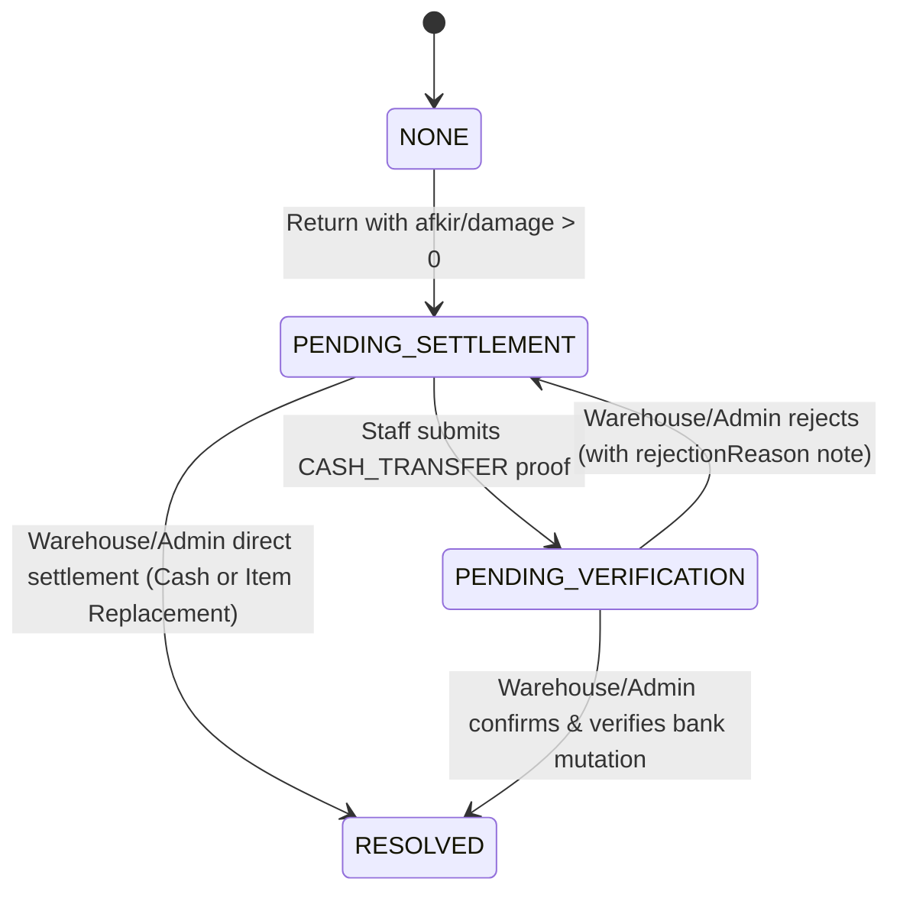

# ADR-0106: Hybrid Staff Cash Settlement Submission and Warehouse Verification Workflow

- **Date:** 2026-11-11
- **Status:** APPROVED
- **Author:** Senior Software Engineer & Principal Systems Architect
- **Context:** Equipment inventory compensation settlement lifecycle.

---

## 1. Context & Business Problem

In ADR-0050 and ADR-0052, Vrello Up established an operational workflow for handling damaged or lost marketing equipment (`BorrowRecord`), introducing compensation obligations (`compensationStatus: "PENDING_SETTLEMENT"`) and a settlement endpoint guarded by the Four-Eyes Principle (`hasPermission(role, "PROCESS_RETURN")`).

Under the original ADR-0052 implementation, only users with `warehouse`, `supervisor`, or `admin` roles could open the settlement modal and submit liability resolution. While this strict restriction protected against borrowers marking their own liabilities as resolved, real-world field operations revealed significant friction:

1. **Remote Bank Transfer Friction:**  
   Field marketing staff frequently operate remotely across distant cities or event venues. When settling liabilities via mobile banking / bank transfer (`CASH_TRANSFER`), staff make payments outside warehouse operating hours. Under the existing architecture, staff have no self-service mechanism in Vrello Up to attach their transfer slips. Instead, they must manually contact warehouse staff via WhatsApp or personal chat, sending screenshot receipts and pleading with warehouse coordinators to log into Vrello Up and upload the proofs on their behalf. This leads to lost receipts, unverified pending liabilities, and administrative fatigue.

2. **The Hazard of Unverified Physical Item Replacement (`ITEM_REPLACEMENT`):**  
   If the system naively allowed staff to submit settlements for both modes, borrowers could claim physical item replacement from home by uploading a photo of a box or receipt. Because ADR-0052 automatically increments catalog inventory (`totalUnits` and `availableUnits`) upon resolution of an `ITEM_REPLACEMENT`, allowing virtual submission risks **Phantom Stock**—where system numbers increase before physical units are physically inspected and placed on warehouse shelves.

3. **Need for a Balanced Hybrid Solution:**  
   The business requires an architecture that empowers staff with asynchronous, self-service proof submission for bank transfers while strictly safeguarding physical warehouse inventory integrity and preserving the Four-Eyes Principle.

---

## 2. Options Considered

### Option 1: Status Quo (Strict Warehouse/Admin Desk Settlement Only)
Keep the existing ADR-0052 behavior without changes. Staff must physically meet warehouse staff or send receipts via external chat channels.
- **Pros:** Zero engineering effort, zero state machine changes, zero database migration.
- **Cons:** High operational friction for remote field staff; delays liability clearance; unorganized receipt tracking in personal chat histories.

### Option 2: Hybrid Staff Self-Service Submission with Warehouse Verification (Chosen)
Permit borrower `staff` (or officers with `PROCESS_RETURN`) to submit cash transfer receipts (`CASH_TRANSFER` mode only) directly in Vrello Up.
- Submission transitions status from `"PENDING_SETTLEMENT"` to `"PENDING_VERIFICATION"`.
- Mode `ITEM_REPLACEMENT` remains strictly locked to `warehouse` and `admin` roles, requiring in-person counter handover.
- Warehouse / Admin officers review submitted transfer proofs and execute either **Confirm** (`RESOLVED`) or **Reject** (returns to `PENDING_SETTLEMENT` with mandatory rejection note).
- Warehouse / Admin officers retain the existing 1-step direct resolution capability on the spot.
- **Pros:** Eliminates WhatsApp friction; maintains airtight audit trails; protects against phantom inventory; respects Four-Eyes Principle.
- **Cons:** Introduces intermediate state `"PENDING_VERIFICATION"` and rejection handler.

### Option 3: Full Two-Step Workflow for All Settlement Modes
Open both `CASH_TRANSFER` and `ITEM_REPLACEMENT` to staff submission with an asynchronous queue for all cases.
- **Pros:** Fully generalized lifecycle.
- **Cons:** Dangerous operational loophole where phantom inventory is confirmed on photos alone; unnecessary bureaucracy when warehouse and staff are standing together at the counter.

---

## 3. Deep Trade-Off & Feasibility Matrix

| Evaluation Dimension | Option 1 (Status Quo) | Option 2 (Hybrid Staff Cash Submission) | Option 3 (Full Two-Step All Modes) |
| :--- | :--- | :--- | :--- |
| **Business Continuity & User Velocity** | Low (staff blocked without warehouse officer present) | **High (staff submits asynchronously anytime)** | High (staff submits asynchronously anytime) |
| **Phantom Inventory Protection** | High (in-person only) | **High (physical items strictly in-person)** | Critical Risk (virtual item approvals) |
| **Four-Eyes Governance** | High (staff cannot self-resolve) | **High (staff only submits, admin/warehouse approves)** | High (approval required) |
| **Cognitive & Engineering Overhead** | None | **Low (single new state + reject/confirm actions)** | Medium-High (dual queues, complex state branches) |
| **Auditability & Proof Preservation** | Poor (proofs scattered across chat apps) | **Air-tight (proofs uploaded directly to Supabase storage)** | Air-tight |

---

## 4. Decision & Explicit Architecture

We choose **Option 2: Hybrid Staff Cash Settlement Submission and Warehouse Verification**.

### 4.1. State Machine Extension
The `compensationStatus` enum/string is extended to:
- `"NONE"`: No damage or afkir liability.
- `"PENDING_SETTLEMENT"`: Equipment was returned damaged/lost; compensation is pending submission.
- `"PENDING_VERIFICATION"`: Staff has uploaded bank transfer proof; awaiting warehouse/admin verification.
- `"RESOLVED"`: Payment verified by warehouse/admin or physical item inspected & restocked.

### 4.2. RBAC & Mutation Contracts
1. **Endpoint: `POST /api/marcom/inventory/borrow/[id]/settle/submit` (or unified `/settle` with action):**
   - **Allowed Roles:** `staff` (must match `borrowerName` or `borrowRecord.borrowerName`), `warehouse`, `supervisor`, `admin`.
   - **Enforced Mode:** Strictly `settlementType === "CASH_TRANSFER"`. If a staff caller attempts `ITEM_REPLACEMENT`, reject with `HTTP 403 Forbidden` (`"Penggantian unit fisik wajib diserahkan dan diverifikasi langsung oleh petugas gudang"`).
   - **Payload:** `settledAmount`, `settlementNotes`, `settlementProofUrls: String[]` (min 1 proof).
   - **Effect:** Sets `compensationStatus = "PENDING_VERIFICATION"`, records `submittedAt = new Date()`, `submittedBy = session.userName`.
2. **Endpoint: `POST /api/marcom/inventory/borrow/[id]/settle/verify` (or `/settle` with action="CONFIRM" | "REJECT"):**
   - **Allowed Roles:** Strictly requires `hasPermission(role, "PROCESS_RETURN")` (`warehouse`, `supervisor`, `admin`). Requests from `staff` or `viewer` are rejected with `HTTP 403 Forbidden`.
   - **Action `CONFIRM`:**
     - Transitions `compensationStatus = "RESOLVED"`.
     - Records `settledAt = new Date()`, `settledBy = reviewerUserName`.
     - In `CASH_TRANSFER` mode: locks `settledAmount` into company revenue logs.
   - **Action `REJECT`:**
     - Requires `rejectionReason: String` (non-empty).
     - Transitions `compensationStatus = "PENDING_SETTLEMENT"`.
     - Appends rejection audit log into record notes so staff knows why the submission was rejected.
3. **Preserved In-Person Fast Path:**
   - When a warehouse coordinator or admin performs settlement directly, they can immediately transition `PENDING_SETTLEMENT` to `RESOLVED` in 1 step without going through `PENDING_VERIFICATION`.

### 4.3. UI / UX Adaptations
1. **`BorrowDetailModal.tsx`:**
   - If user is `staff` (borrower) and `compensationStatus === "PENDING_SETTLEMENT"`:
     - Shows button: `"Kirim Bukti Pelunasan Transfer"`.
     - Opens `BorrowSettlementModal.tsx` in Staff Mode.
   - If `compensationStatus === "PENDING_VERIFICATION"`:
     - Shows status badge: `"Menunggu Konfirmasi Gudang/Admin"` (amber warning pill).
     - If user has `PROCESS_RETURN`: shows action buttons `"Konfirmasi Pelunasan"` and `"Tolak Bukti"`.
     - If user is `staff`: shows informational banner `"Bukti transfer Anda telah dikirim dan sedang menunggu konfirmasi admin/gudang."`
2. **`BorrowSettlementModal.tsx`:**
   - When opened by `staff`:
     - Mode toggle is locked to `"Pembayaran Kas / Transfer Bank"`.
     - The `"Penggantian Barang Fisik"` toggle is disabled with a descriptive tooltip / helper text.

---

## 5. Consequences & Trade-offs

### Positive Consequences
- **Asynchronous User Empowerment:** Field staff are no longer blocked outside warehouse operating hours to settle liabilities.
- **Zero Phantom Stock Risk:** Physical inventory cannot be restocked by virtual submissions; stock restoration remains tightly coupled to physical warehouse counter verification.
- **Strict Four-Eyes Compliance:** Staff can never approve their own liability. The final state transition to `RESOLVED` is exclusively guarded by warehouse or admin credentials.
- **Audit Traceability:** Bank transfer receipts are uploaded directly into Supabase Storage (`inventory-damage` bucket with prefix `settlement/`), eliminating lost screenshots across personal messaging apps.

### Accepted Technical Debt & Mitigations
- Adding `"PENDING_VERIFICATION"` expands `compensationStatus` values. Existing queries filtering by `compensationStatus === "PENDING_SETTLEMENT"` must be checked to ensure pending verification records remain visible under outstanding liability filters.
- Rejection reasons are stored in `settlementNotes` or a dedicated `rejectionReason` string.

---

## 6. Verification & Invariants

1. **RBAC Guard Invariant:** Staff callers cannot invoke `CONFIRM` or settle `ITEM_REPLACEMENT` under any circumstances (HTTP 403 Forbidden).
2. **Ownership Guard Invariant:** A staff caller can only submit settlement proofs for their own `BorrowRecord` (matched by `borrowerName`).
3. **Proof Verification Invariant:** Submissions with zero proof URLs are rejected with HTTP 422 Unprocessable Entity.
4. **Non-Negotiable Gates:** `npm run drift:check`, `npm run build:check`, and `npm test` must pass with 0 failures and 0 errors.

