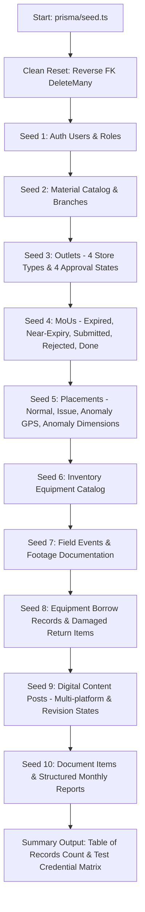

# QA Comprehensive Seeder Design Specification — vrello-up

**Date:** 2026-10-31  
**Status:** DRAFT / PROPOSED  
**Author:** Critical Senior Software Engineer (Pair Programmer)  
**Target:** `prisma/seed.ts`  

---

## 1. Executive Summary

The current seeder (`prisma/seed.ts`) populates standard baseline data but lacks critical QA "what if" edge cases across key business workflows:
1. `BorrowRecord` and `BorrowItem` entities are completely unseeded (0 records).
2. Users are limited to a single admin account, omitting Staff, Viewer, Pending, and Rejected accounts.
3. Outlets, MoUs, and Placements lack deliberate SLA anomalies, approval lifecycles (Draft, Pending Approval, Rejected with reason), geolocation deviations (>500m), and expired/near-expiry contracts.
4. Relative dates are hardcoded to fixed historical timestamps, causing SLA aging and contract countdowns to drift or become static.

This specification defines a comprehensive, deterministic, self-contained single-file seeder in `prisma/seed.ts` that:
- Executes clean database truncation in reverse foreign-key topological order.
- Generates realistic corporate Indonesian master data and operational records without synthetic `[QA]` tags.
- Uses dynamic relative dates based on `Date.now()` so SLA and aging indicators (overdue borrows, expiring MoUs, pending approvals) remain perpetually active and realistic.
- Embeds specific "what if" edge cases for QA testing across all application views (Kanban Board, List, Calendar, Pipeline, Outlets 360°, MoUs, Placements, Events, Inventory, Documents, Reports).

---

## 2. Seeding Strategy & Execution Flow

### 2.1 Database Reset Protocol
Before inserting records, `main()` performs atomic batch deletions in strict reverse dependency order to prevent foreign key constraint violations:
1. `BorrowItem`
2. `BorrowRecord`
3. `EventFootage`
4. `Placement`
5. `Mou`
6. `FieldEvent`
7. `ContentPost`
8. `DocumentItem`
9. `MonthlyReport`
10. `InventoryItem`
11. `Outlet`
12. `Material`
13. `Branch`
14. `User`

---

## 3. Detailed "What If" QA Scenarios Matrix

### 3.1 Authentication & User Role Lifecycle (`User`)
All accounts use the deterministic development password: `changeme123` (bcrypt hash rounds: 10 for rapid seed execution).

| User Email | Role | Status | "What If" Scenario & Purpose |
|---|---|---|---|
| `admin@vrelloup.dev` | `ADMIN` | `APPROVED` | Super admin access to user management, approvals, inventory deletion, and settings |
| `staff.budi@vrelloup.dev` | `STAFF` | `APPROVED` | Standard operational staff: can edit tasks, submit draft outlets, request equipment |
| `staff.dewi@vrelloup.dev` | `STAFF` | `APPROVED` | Field coordinator PIC for Central Java branches |
| `viewer.hendra@vrelloup.dev` | `VIEWER` | `APPROVED` | Read-only stakeholder: cannot edit, submit, or approve |
| `pending.siti@vrelloup.dev` | `STAFF` | `PENDING` | Newly registered user: blocked by middleware with pending alert |
| `rejected.agus@vrelloup.dev` | `STAFF` | `REJECTED` | Disapproved registration: blocked by middleware with rejection notice |

### 3.2 Master Infrastructure (`Branch` & `Outlet`)
Covers major economic corridors (Central Java, DI Yogyakarta, West Java, East Java, Bali) with realistic Indonesian retail naming.

| Outlet Category / Code | Type | Status | "What If" QA Testing Scenario |
|---|---|---|---|
| `OUT-SMG-001` (Sinar Jaya Cellular) | `MODERN_RETAIL` | `APPROVED` | Baseline healthy outlet: multiple active placements, valid MoU, ongoing events |
| `OUT-SMG-002` (Berkah Abadi Ponsel) | `TRADITIONAL` | `APPROVED` | Bottleneck outlet: placement stuck with `ISSUE`, MoU expired |
| `OUT-YOG-003` (Jogja Mobile Point) | `CAMPUS_OUTLET` | `PENDING_APPROVAL` | Outlet submitted by field PIC, awaiting admin verification in Outlet Approval Queue |
| `OUT-SLO-004` (Solo Gadget Center) | `EXCLUSIVE` | `REJECTED` | Rejected outlet with realistic reason: *"Lokasi berada di dalam gang sempit, visibilitas brand tidak memadai"* |
| `OUT-BDG-005` (Kios Pulsa Barokah) | `TRADITIONAL` | `DRAFT` | Draft outlet without coordinates or photo |
| `OUT-MLG-006` (Sentral Ponsel Nusantara) | `MODERN_RETAIL` | `APPROVED` | Cold / Orphan outlet: active but 0 MoUs, 0 placements, 0 events (tests empty state handling) |
| `OUT-DPS-007` (Dewata Cell Express) | `EXCLUSIVE` | `APPROVED` | Inactive outlet (`active: false`) for filter verification |

### 3.3 MoUs & Legal Contract Funnel (`Mou`)
Relative dates anchored to `now = Date.now()`:

| Scenario / MoU ID | Status | Expiry / Term | Value (IDR) | "What If" QA Behavior |
|---|---|---|---|---|
| `MOU-EXP-001` | `APPROVED` | Expired `now - 45 days` | Rp 24.000.000 | Triggers `CRITICAL` urgency in Pipeline SLA aging, red status chip |
| `MOU-SOON-002` | `APPROVED` | Expiring in `now + 8 days` | Rp 36.000.000 | Triggers `WARNING` urgency (expiring within 14 days) |
| `MOU-SUB-003` | `SUBMITTED` | Submitted `now - 65 days` | Rp 15.000.000 | Pending approval aging >60 days; tests approval bottleneck counter |
| `MOU-DRAFT-004` | `DRAFT` | No end date | Rp 0 | Zero compensation value draft contract |
| `MOU-REJ-005` | `REJECTED` | Terminated `now - 10 days` | Rp 12.000.000 | Rejected MoU with notes: *"Kompensasi tidak disetujui divisi finance"* |
| `MOU-JUMBO-006` | `APPROVED` | 2-year term (`now + 500 days`) | Rp 150.000.000 | High-value flagship contract testing large number formatters (e.g., `Rp 150 Jt`) |

### 3.4 POSM Placements & Geolocation Verification (`Placement`)

| Scenario | Status | Material | Geolocation Deviation | "What If" QA Behavior |
|---|---|---|---|---|
| Baseline Done | `DONE` | Shopblind | Deviation 12m (`isLocationValid: true`) | Healthy completed installation with photo and coordinates |
| GPS Anomaly | `DONE` | Branding Signboard | Deviation 1.450m (`isLocationValid: false`) | GPS spoofing / inaccurate photo check-in detection |
| Problem Issue | `ISSUE` | Neon Box | Deviation 0m, notes present | Installation blocked: *"Etalase dibongkar pemilik toko untuk renovasi"* |
| Missing Coord | `ON_PROGRESS` | Banner | `latitude: null`, `longitude: null` | In-progress task without map pinning |
| Permanent No MoU | `NOT_STARTED` | Branding Signboard | N/A (`mouId: null`) | Violates permanent material rule; tests policy warnings |
| Extreme Dims | `DONE` | Billboard / Facade | Dimensions `"1200 x 400 cm"` | Extreme dimension string formatting |

### 3.5 Inventory & Borrow Logistics (`InventoryItem` & `BorrowRecord`)

#### Inventory Catalog (`InventoryItem`):
- 16 equipment master items across 5 categories (`Audio/Visual`, `Staging/Booth`, `Merchandising/Display`, `Electrical/Cables`, `Furniture/Logistics`).
- Statuses: `AVAILABLE`, `BORROWED` (0 available units), `MAINTENANCE`, `RETIRED`.

#### Borrow Records (`BorrowRecord` & `BorrowItem`):
1. **Overdue Borrow (`BRW-20261015-001`):** Borrowed 20 days ago, due `now - 6 days`, status `OVERDUE`. Attached to a field event. Triggers overdue badge on event cards and inventory kanban.
2. **Active Borrow (`BRW-20261028-002`):** Borrowed 3 days ago, due `now + 4 days`, status `ACTIVE`. 4 items decremented from available units.
3. **Pending Request (`BRW-20261030-003`):** Submitted yesterday, status `PENDING`, awaiting approval by admin.
4. **Returned with Damages (`BRW-20261020-004`):** Status `RETURNED`. Item condition check-in: Folding Tent has `MAJOR_DAMAGE` (canopy torn during storm) and 1 wireless mic `LOST`. Restores non-lost equipment units, records incident damage report.
5. **Cancelled Borrow (`BRW-20261022-005`):** Status `CANCELLED` due to rainy season event cancellation.

### 3.6 Field Events & Digital Content

#### Events:
- **Upcoming (`UPCOMING`):** Campus Roadshow next week, budget Rp 15.000.000, linked to borrow records.
- **In-Progress (`ON_PROGRESS`):** Festival Musik UMKM happening today, attendee count streaming.
- **Completed (`COMPLETED`):** Car Free Day activation with 2 video footage attachments (`EventFootage`).
- **Cancelled (`CANCELLED`):** Community Gathering cancelled due to permits, 0 actual attendees.

#### Content Posts:
- **Published:** Instagram Carousel & TikTok Reels with live media URLs.
- **Revision Needed:** Status `REVISION_NEEDED`, revision notes: *"Warna logo IM3 terlalu pucat, mohon sesuaikan dengan color code brand guideline #FFD800"*, includes 3 checklist subtasks.
- **Draft / Scheduled:** Posts scheduled across upcoming calendar dates.

### 3.7 Documentation & Reports
- **Documents:** 12 documents with various extensions (`.pdf`, `.xlsx`, `.zip`, `.csv`), file sizes from 0.8 MB to 94.5 MB (testing large file size badges).
- **Monthly Reports:** 4 quarterly reports containing rich JSON data (`summary`, `activities`, `achievements`, `keyIssues`, `actionPlans`).

---

## 4. Verification & Testing Checklist

- [ ] `prisma/seed.ts` compiles without TypeScript errors (`npx tsc --noEmit`).
- [ ] Running `npm run prisma:seed` or `tsx prisma/seed.ts` runs cleanly in < 10 seconds.
- [ ] Database record counts match expected test distributions.
- [ ] Re-running the seed is 100% idempotent and resets state without unique key collision.
- [ ] Full automated test suite passes (`npm test`) with 0 failures.
- [ ] Invariant drift check passes (`npm run drift:check`).
