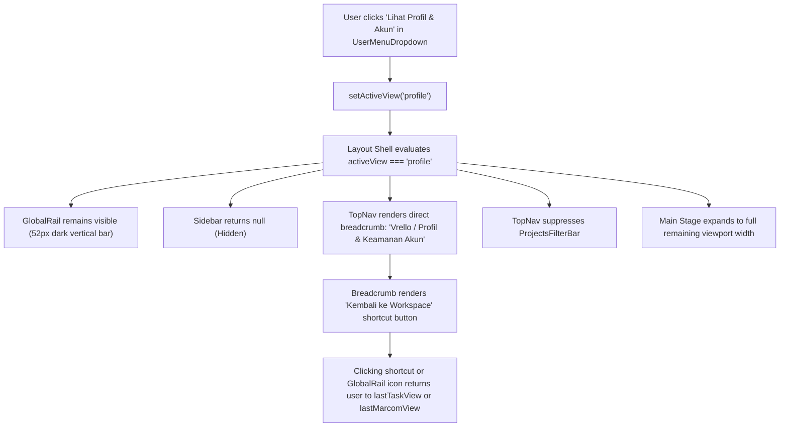

# Design Specification: Global View Layout Isolation & Profile Hierarchy

**Date:** 2026-11-01  
**Author:** Critical Senior Software Engineer (Pair Programmer)  
**Status:** Approved  
**Related Plan:** `docs/superpowers/plans/2026-11-01-profile-layout-hierarchy.md`  
**ADR:** `docs/adr/0009-global-view-layout-isolation-and-profile-hierarchy.md`  

---

## 1. Executive Summary

When viewing the dedicated User Profile view (`activeView: "profile"`), the application layout previously suffered from three Information Architecture (IA) and visual flaws:
1. Breadcrumb showed `Vrello / Projects / profile`, nesting personal account settings under the operational Projects module.
2. `TopNav` displayed the `ProjectsFilterBar` ("Search work items...", "All", "Content", "Event", "Placement", "More Filters") directly above the profile view.
3. The 240px wide operational `Sidebar` (showing the Projects/Marcom mode switcher and Kanban/List/Calendar buttons) remained open, crowding the profile stage with irrelevant navigation items.

This specification isolates layout rules for Global Account Views (`profile`), completely hiding the contextual `Sidebar` on `profile` while retaining the 52px `GlobalRail` as the persistent global anchor. It restructures `TopNavBreadcrumbs` to render `Vrello / Profil & Keamanan Akun` directly after the root brand anchor with an instant "Kembali ke Workspace" shortcut, gates `ProjectsFilterBar` strictly to task work items (`board`, `list`, `calendar`), and preserves `lastTaskView` state in `createUiSlice.ts`.

---

## 2. UX Flow



### Detailed UX Interaction:
1. **Entry:** User opens `UserMenuDropdown` from `TopNav` and clicks **"Lihat Profil & Akun"**.
2. **Layout Presentation:**
   - The dark **Global Rail** on the far left remains anchored with icons for Home, Calendar, AI, and Users.
   - The white/dark **Sidebar** (240px) is suppressed, allowing the profile cards (Personal Info, RBAC Branch Badges, Password Form) to render in full, generous two-column desktop width.
   - **TopNav Breadcrumb** displays `Vrello` / `Profil & Keamanan Akun` with a clean `User` icon.
   - A subtle, accessible **"Kembali ke Workspace"** button appears in the breadcrumb trail.
   - No task search or work item filter chips are rendered.
3. **Exit:** The user can navigate back to their previous work context at any moment by:
   - Clicking **"Kembali ke Workspace"** in the breadcrumb.
   - Clicking **Home**, **Calendar**, or **Users** in the `GlobalRail`.
   - Selecting any option from the Command Palette (`Cmd+K`).

---

## 3. SSOT Schema Changes (`src/types/index.ts`)

No changes required to database or core domain models. All existing types (`ViewMode`, `UserProfileResponse`, `UpdateProfilePayload`) remain canonical.

Helper classification constants will be defined in a pure helper module `src/components/layout/layoutHierarchyHelpers.ts`:
```typescript
import type { ViewMode } from "@/types";

export const WORK_ITEM_VIEWS = new Set<ViewMode>(["board", "list", "calendar"]);

export const GLOBAL_ACCOUNT_VIEWS = new Set<ViewMode>(["profile", "users"]);

export function isWorkItemView(view: ViewMode | string): boolean {
  return WORK_ITEM_VIEWS.has(view as ViewMode);
}

export function isGlobalAccountView(view: ViewMode | string): boolean {
  return GLOBAL_ACCOUNT_VIEWS.has(view as ViewMode);
}
```

---

## 4. SQL / Prisma Schema Changes

None. This is purely a frontend layout and information architecture enhancement.

---

## 5. Pure Logic Function Signatures

In `src/components/layout/layoutHierarchyHelpers.ts`:

```typescript
/**
 * Resolves whether the contextual Sidebar should be rendered for the active view.
 */
export function shouldRenderSidebar(activeView: ViewMode | string): boolean;

/**
 * Resolves whether the ProjectsFilterBar should be rendered in TopNav.
 */
export function shouldRenderProjectsFilterBar(
  appMode: string,
  activeView: ViewMode | string
): boolean;

/**
 * Resolves breadcrumb configuration for global account views.
 */
export function getGlobalBreadcrumbInfo(activeView: ViewMode | string): {
  label: string;
  iconName: "user" | "users" | "home";
} | null;
```

---

## 6. API Contracts

None. No new network APIs are created.

---

## 7. Acceptance Criteria

- [ ] **AC 1 (Sidebar Hidden on Profile):** When `activeView === "profile"`, `Sidebar.tsx` returns `null` and is not rendered in the DOM.
- [ ] **AC 2 (GlobalRail Retained):** When `activeView === "profile"`, `GlobalRail` remains permanently visible and interactive at 52px width on desktop.
- [ ] **AC 3 (Direct Root Breadcrumb):** When `activeView === "profile"`, `TopNavBreadcrumbs` renders `Vrello` / `Profil & Keamanan Akun` directly, with no `Projects` or `Marketing Hub` segment.
- [ ] **AC 4 (Return Shortcut):** `TopNavBreadcrumbs` displays a "Kembali ke Workspace" button when viewing `profile`, returning to `lastTaskView` (or `lastMarcomView`).
- [ ] **AC 5 (Filter Bar Suppressed):** `ProjectsFilterBar` does NOT render when `activeView === "profile"`. It only renders when `appMode === "tasks"` AND `activeView` is one of `board`, `list`, or `calendar`.
- [ ] **AC 6 (State Preservation):** Navigating to `profile` does not mutate or overwrite `lastTaskView` in Zustand store.
- [ ] **AC 7 (Coordinator File Limits):** All modified coordinators remain $\le 250$ LOC (`Sidebar.tsx`, `TopNav.tsx`, `TopNavBreadcrumbs.tsx`, `createUiSlice.ts`).
- [ ] **AC 8 (Zero Verification Errors):** `npm run drift:check`, `npm run build:check`, `npm test` all pass with 0 failures.

---

## 8. Non-Goals

- Creating a separate Next.js route directory with a separate root layout (unnecessary layout churn; SPA stage handles this seamlessly with instant transitions).
- Modifying the internal components of `ProfileView.tsx` (the form components and backend API are already verified and complete).
- Hiding `GlobalRail` (GlobalRail must always stay visible as the application anchor).

---

## 9. Verification Checklist

1. `npm run drift:check` passes with 0 drift and paired spec/plan.
2. `npm run build:check` passes with 0 TypeScript compilation errors.
3. Unit tests for `layoutHierarchyHelpers.test.ts` pass 100%.
4. `npm test` passes with 0 failures across all test suites.
5. Visual verification confirms `Sidebar` is hidden on `profile`, `GlobalRail` is visible, breadcrumb is direct, and `ProjectsFilterBar` is absent.
