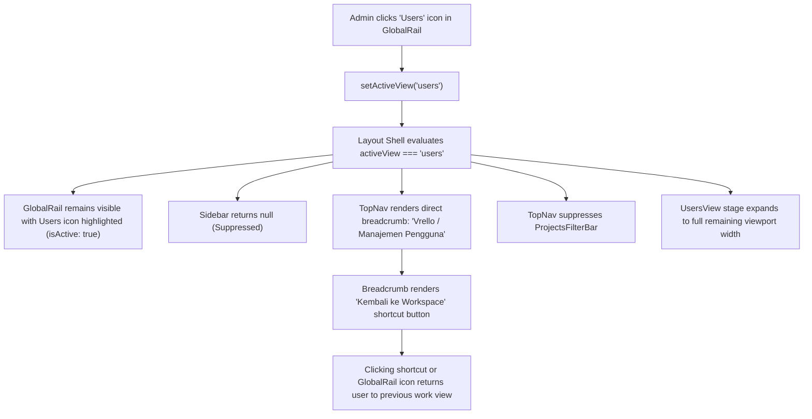

# Design Specification: User Management Global View Layout Isolation

**Date:** 2026-11-01  
**Author:** Critical Senior Software Engineer (Pair Programmer)  
**Status:** Approved  
**Related Plan:** `docs/superpowers/plans/2026-11-01-user-management-global-layout.md`  
**ADR:** `docs/adr/0010-user-management-global-view-layout-isolation.md`  

---

## 1. Executive Summary

User Management (`activeView: "users"`, `UsersView.tsx`) is an administration-level workspace view accessible exclusively to administrators from `GlobalRail`. Previously, navigating to User Management kept the 240px wide operational `Sidebar` (showing Projects or Marcom menu items like Kanban Board, List, Calendar, or Operations & Planning) open alongside the user management audit table. This cramped table column widths, forced horizontal scrollbars on medium screens, and introduced irrelevant operational navigation items.

This specification unifies the layout isolation rules established in ADR 09 and ADR 10 by extending sidebar suppression to `activeView === "users"`. While on User Management, the contextual `Sidebar` returns `null`, the 52px `GlobalRail` remains persistently active with the `Users` icon highlighted, `TopNavBreadcrumbs` displays `Vrello / Manajemen Pengguna` with a return shortcut, and `UsersView` expands to full widescreen viewport width.

---

## 2. UX Flow



### Detailed UX Interaction:
1. **Entry:** Administrator clicks the **Users** icon in the persistent `GlobalRail`.
2. **Layout Presentation:**
   - The dark **Global Rail** (52px) remains visible at the far left with the `Users` icon in active state.
   - The contextual **Sidebar** (240px) is suppressed.
   - The User Management stage (`UsersView`) expands into the newly available 240px horizontal space, providing ample room for user cards, RBAC role dropdowns, branch chips, and approval/rejection modal actions.
   - **TopNav Breadcrumb** displays `Vrello` / `Manajemen Pengguna` with a clean `Users` icon and an instant **"Kembali ke Workspace"** button.
   - **ProjectsFilterBar** remains hidden.
3. **Exit:** The administrator can return to work item or marketing operations at any moment by clicking **"Kembali ke Workspace"** in the breadcrumb, or by selecting **Home**, **Calendar**, or **AI** from `GlobalRail`.

---

## 3. SSOT Schema Changes (`src/types/index.ts`)

No changes required. `ViewMode`, `AppUser`, and `UserStatus` already exist in the SSOT types directory.

---

## 4. SQL / Prisma Schema Changes

None. Pure frontend layout and navigation hierarchy enhancement.

---

## 5. Pure Logic Function Signatures

In `src/components/layout/layoutHierarchyHelpers.ts`:

```typescript
export const GLOBAL_ACCOUNT_VIEWS = new Set<ViewMode>([
  "profile",
  "users",
]);

/**
 * Resolves whether the contextual module Sidebar should be rendered.
 * Suppresses module sidebar for both personal profile and administrative user management.
 */
export function shouldRenderSidebar(activeView: ViewMode | string): boolean {
  if (GLOBAL_ACCOUNT_VIEWS.has(activeView as ViewMode)) {
    return false;
  }
  return true;
}
```

---

## 6. API Contracts

None. No new network APIs are created.

---

## 7. Acceptance Criteria

- [ ] **AC 1 (Sidebar Hidden on Users View):** When `activeView === "users"`, `Sidebar.tsx` returns `null` and is not rendered in the DOM.
- [ ] **AC 2 (GlobalRail Retained & Active):** When `activeView === "users"`, `GlobalRail` remains visible at 52px width with the `Users` icon displaying active state (`isActive: true`).
- [ ] **AC 3 (Direct Root Breadcrumb):** When `activeView === "users"`, `TopNavBreadcrumbs` renders `Vrello` / `Manajemen Pengguna` directly, with no `Projects` or `Marketing Hub` intermediate segment.
- [ ] **AC 4 (Return Shortcut):** `TopNavBreadcrumbs` displays a "Kembali ke Workspace" button when viewing `users`, returning to `lastTaskView` (or `lastMarcomView`).
- [ ] **AC 5 (Filter Bar Suppressed):** `ProjectsFilterBar` remains suppressed when `activeView === "users"`.
- [ ] **AC 6 (Widescreen Table Rendering):** `UsersView` expands to occupy full available width without horizontal truncation.
- [ ] **AC 7 (Coordinator File Limits):** All modified coordinators remain $\le 250$ LOC (`Sidebar.tsx`, `TopNavBreadcrumbs.tsx`, `TopNav.tsx`, `createUiSlice.ts`).
- [ ] **AC 8 (Zero Verification Errors):** `npm run drift:check`, `npm run build:check`, and `npm test` all pass with 0 failures.

---

## 8. Non-Goals

- Changing user administration logic or approval APIs (existing `/api/admin/users` routes and `UsersView` components are already tested and complete).
- Hiding `GlobalRail` on the `users` view.

---

## 9. Verification Checklist

1. `npm run drift:check` passes with 0 drift and paired spec/plan.
2. `npm run build:check` passes with 0 TypeScript compilation errors.
3. Unit tests in `layoutHierarchyHelpers.test.ts` updated and passing 100%.
4. Smoke tests pass with 0 failures (`npm run test:smoke`).
5. Full test suite passes with 0 failures (`npm test`).

