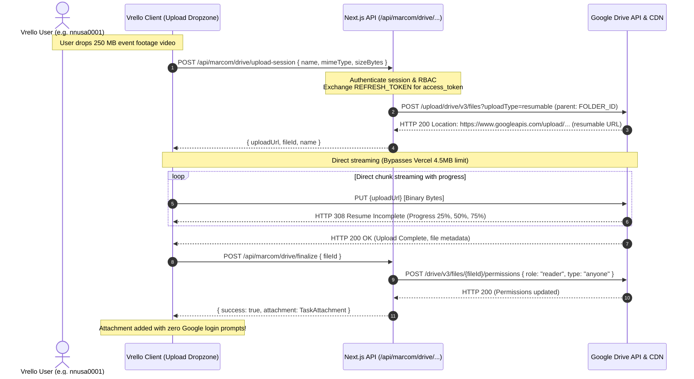

# Design Specification: Centralized Google Drive Storage via Developer Refresh Token and Direct Resumable Uploads

**Date:** 2026-11-02  
**Author:** Critical Senior Software Engineer (Pair Programmer)  
**Status:** Approved  
**Related Plan:** `docs/superpowers/plans/2026-11-02-centralized-drive-upload.md`  
**ADR:** `docs/adr/0011-centralized-google-drive-storage-refresh-token.md`  

---

## 1. Executive Summary

Vrello requires a robust mechanism for marketing teams to upload large media files (B-roll footage, event recap videos, and multi-page MOU documents) without forcing team members to sign into their personal Google accounts, without consuming personal user storage quotas, and without failing on Vercel's strict 4.5 MB serverless function payload limit.

This specification establishes a **Centralized Server-to-Cloud Upload System** backed by a **Developer OAuth2 Refresh Token** (`vickygp5571@gmail.com`) and **Direct Browser-to-Google Resumable Upload Sessions**. Team members upload directly to the developer's designated Google Drive folder with live progress bars. Uploaded files automatically receive public read permissions (`anyoneWithLink`), guaranteeing zero 403 access barriers when previewed in embedded iframes across Content Planner, Field Events, and Document Management.

---

## 2. UX Flow



### Detailed UX Interaction:
1. **Selection:** Inside any creation or edit modal (Content Planner, Field Events, MOUs, Documents Center), the user clicks **"Unggah ke Cloud Drive"** or drags a file into the upload zone.
2. **Seamless Authorization:** The user is **never** presented with a third-party Google sign-in popup or consent screen.
3. **Progress Feedback:** A smooth progress bar indicates upload percentage and upload speed directly to Google's CDN.
4. **Instant In-App Preview:** Once finished, the file appears in the attachment list with a `Google Drive` badge, instant 16:9 playback in [`GoogleDrivePreviewModal`](file:///Users/mac/Web%20Development/vrello-up/src/components/ui/GoogleDrivePreviewModal.tsx), and full metadata.

---

## 3. SSOT Schema Changes (`src/types/index.ts`)

No breaking changes to `TaskAttachment`. We augment the SSOT types with session initiation contracts:

```typescript
export interface DriveUploadSessionRequest {
  name: string;
  mimeType: string;
  sizeBytes: number;
}

export interface DriveUploadSessionResponse {
  uploadUrl: string;
  fileId: string;
  name: string;
  folderId?: string;
}

export interface DriveFinalizeRequest {
  fileId: string;
  name: string;
  mimeType: string;
  sizeBytes: number;
}

export interface DriveFinalizeResponse {
  success: boolean;
  attachment: TaskAttachment;
}
```

---

## 4. SQL / Prisma Schema Changes

None. Attachments continue to be stored as JSON arrays in database work item fields or document records.

---

## 5. Pure Logic Function Signatures

All core network request payloads, header generators, and error mappers are isolated into pure, deterministic helper modules:

### `src/lib/marcom/driveTokenHelpers.ts`
```typescript
export interface TokenExchangeParams {
  clientId: string;
  clientSecret: string;
  refreshToken: string;
}

export function buildTokenRequestBody(params: TokenExchangeParams): string;
export function parseTokenResponse(body: unknown): { accessToken: string; expiresIn: number };
```

### `src/lib/marcom/driveUploadHelpers.ts`
```typescript
export interface ResumableSessionHeaders {
  accessToken: string;
  mimeType: string;
  sizeBytes: number;
}

export function buildResumableSessionHeaders(params: ResumableSessionHeaders): Record<string, string>;
export function extractUploadUrl(locationHeader: string | null): string;
export function sanitizeUploadFileName(rawName: string): string;
export function buildDriveAttachment(fileId: string, name: string, mimeType: string, sizeBytes: number): TaskAttachment;
```

---

## 6. API Contracts

### `POST /api/marcom/drive/upload-session`
- **Guards:** NextAuth Session (`req.auth.user`), requires `can("UPLOAD_DOCUMENT")` or work item editing authority.
- **Request Body:**
  ```json
  {
    "name": "mall-roadshow-footage.mp4",
    "mimeType": "video/mp4",
    "sizeBytes": 154200100
  }
  ```
- **Response (200 OK):**
  ```json
  {
    "uploadUrl": "https://www.googleapis.com/upload/drive/v3/files?uploadType=resumable&upload_id=ADPycdu...",
    "fileId": "1g9x...",
    "name": "mall-roadshow-footage.mp4"
  }
  ```
- **Error (401 / 500):**
  ```json
  { "error": "Unauthorized" }
  // or
  { "error": "Google Drive refresh token is not configured on server" }
  ```

### `POST /api/marcom/drive/finalize`
- **Request Body:**
  ```json
  {
    "fileId": "1g9x...",
    "name": "mall-roadshow-footage.mp4",
    "mimeType": "video/mp4",
    "sizeBytes": 154200100
  }
  ```
- **Action:** Sets file permission to `{ role: "reader", type: "anyone" }`.
- **Response (200 OK):**
  ```json
  {
    "success": true,
    "attachment": {
      "id": "gdrive-1730511234-abc1234",
      "name": "mall-roadshow-footage.mp4",
      "sizeBytes": 154200100,
      "type": "video",
      "url": "https://drive.google.com/file/d/1g9x.../view",
      "embedUrl": "https://drive.google.com/file/d/1g9x.../preview",
      "source": "gdrive",
      "driveFileId": "1g9x...",
      "uploadedAt": "2026-11-02T01:30:00.000Z"
    }
  }
  ```

---

## 7. Developer Utility Script (`scripts/get-drive-refresh-token.ts`)

A lightweight CLI tool using Node's standard `http` module:
- Reads `AUTH_GOOGLE_ID` and `AUTH_GOOGLE_SECRET` from `.env.local`.
- Starts a temporary local HTTP server on `http://localhost:3333`.
- Generates an authorization URL requesting scope `https://www.googleapis.com/auth/drive.file` with `access_type=offline&prompt=consent`.
- Automatically opens the developer's default browser.
- Catches the code in callback, trades for `refresh_token`, prints `GOOGLE_DRIVE_REFRESH_TOKEN="..."` to terminal, and shuts down the server.

---

## 8. Acceptance Criteria

- [ ] Developer can generate a refresh token with 1 CLI command (`npm run drive:token`).
- [ ] Users on Vrello can upload files up to several hundred megabytes directly to Google Drive without any OAuth popup.
- [ ] 0 bytes of large file payloads pass through Vercel serverless functions (bypassing the 4.5 MB limit).
- [ ] Uploaded files automatically land in `NEXT_PUBLIC_GOOGLE_DRIVE_FOLDER_ID`.
- [ ] Files receive public read permissions automatically; embedded iframes load without Google 403 errors.
- [ ] Fallback modal (`GoogleDriveLinkModal.tsx`) remains operational for pasting existing links.
- [ ] Full automated test suite covering token exchanges, header builders, URL extractors, and attachment builders with 0 failures.
- [ ] `npm run drift:check`, `npm test`, and `npm run build:check` pass cleanly.

---

## 9. Non-Goals

- Replacing local storage options for small images (<2 MB avatars or icons).
- Building an entire file management tree (renaming/moving folders in Google Drive).
- Automated two-way sync with Google Drive desktop applications.

---

## 10. Verification Checklist

- [ ] Unit tests for `driveTokenHelpers.ts` and `driveUploadHelpers.ts` pass with 100% coverage.
- [ ] End-to-end upload of a >5 MB test file verifies that the file streams directly to Google and returns HTTP 200.
- [ ] Inspection of Google Drive on `vickygp5571@gmail.com` confirms the file exists in the designated folder.
- [ ] Embedded iframe preview test confirms playback works in a logged-out private browser window.

