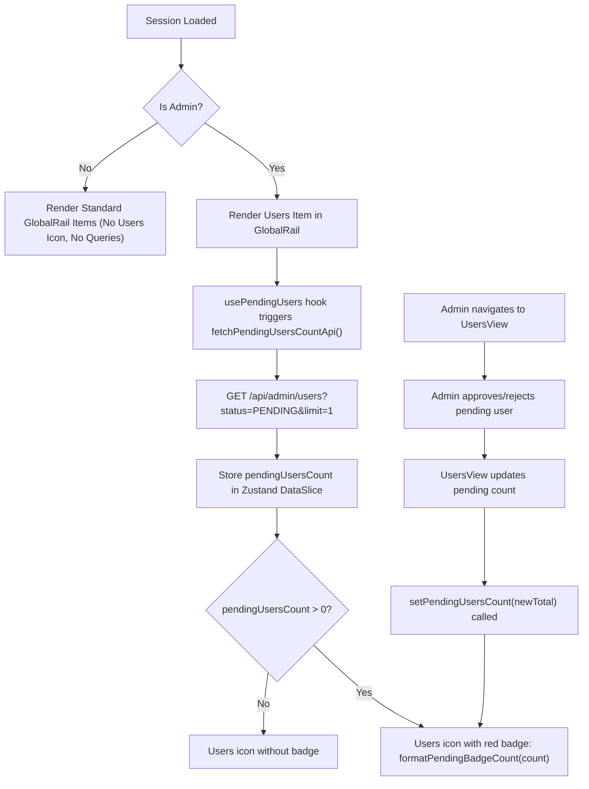

# Design Specification: Global Rail Pending Users Notification Badge

**Date:** 2026-11-02  
**Author:** Critical Senior Software Engineer (Pair Programmer)  
**Status:** Approved  
**Related Plan:** `docs/superpowers/plans/2026-11-02-global-rail-pending-users-badge.md`  
**ADR:** `docs/adr/0012-global-rail-pending-users-badge.md`  

---

## 1. Executive Summary

When new users register in Vrello (via Google OAuth or email credentials), their account is created in `status: "PENDING"` ("Menunggu Review"). Administrators (`role === "admin"`) must review and approve these users before they can access the application.

Previously, `GlobalRail` displayed a static `Users` icon for administrators with no indication of whether any accounts were awaiting review. Administrators had to manually open `/?view=users` to check for pending registrations.

This specification introduces a real-time notification badge on the `Users` icon in `GlobalRail`:
- Renders a small red badge (`bg-rose-500 text-white`) containing the exact number of pending users (`status === "PENDING"`).
- Automatically updates when an administrator approves or rejects an account in `UsersView`.
- Refetches on mount, on window focus, and on a 60-second polling interval for administrators.
- Strictly suppressed for non-administrators (0 extra queries, 0 UI leakage).
- Displays `99+` for counts over 99 and suppresses the badge entirely when count is 0.

---

## 2. UX Flow



### Detailed UX Interaction:
1. **Visibility:** The badge appears only on the `Users` navigation item in `GlobalRail`, which is exclusively visible to users with `role: "admin"`.
2. **Visual Design:**
   - Small circular/pill badge positioned at the top-right corner of the `Users` icon.
   - Red background: `bg-rose-500`.
   - Text styling: `text-white text-[9px] font-bold leading-none`.
   - Contrast separation: `ring-2 ring-[#0F1115]` ensuring crisp contrast against the dark rail.
   - Size: `min-w-3.5 h-3.5 px-1 rounded-full flex items-center justify-center`.
3. **Threshold Formatting:**
   - $0 \to$ No badge rendered (clean icon).
   - $1 \dots 99 \to$ Exact number displayed (e.g. `1`, `3`, `12`).
   - $> 99 \to$ Displays `99+`.
4. **Interaction:** Clicking the `Users` button navigates to `/?view=users` as usual.

---

## 3. SSOT Schema Changes (`src/types/index.ts`)

No domain entity changes required. Existing `AppUser` and `UserStatus` types are sufficient.

---

## 4. SQL / Prisma Schema Changes

None. Queries use existing `status` column on `User` model (`DbUserStatus.PENDING`).

---

## 5. Pure Logic Function Signatures

Module: `src/lib/marcom/pendingUsersHelpers.ts`

```typescript
/**
 * Formats the badge count string.
 * Returns null if count <= 0.
 * Returns "99+" if count > 99.
 * Returns String(count) otherwise.
 */
export function formatPendingBadgeCount(count: number): string | null;

/**
 * Fetches the total count of pending users from the admin API.
 * Fail-safe: Returns 0 on non-200 or network error without throwing.
 */
export function fetchPendingUsersCountApi(
  fetcher?: (url: string) => Promise<Response>
): Promise<number>;
```

---

## 6. API Contracts

Existing endpoint `/api/admin/users`:
- **Method:** `GET`
- **Query:** `?status=PENDING&limit=1`
- **Response:**
  ```json
  {
    "users": [...],
    "total": 3,
    "page": 1,
    "totalPages": 3
  }
  ```
- **Access Control:** Restricted to `session.user.role === "admin"`. Returns `403 Forbidden` for non-admins.

---

## 7. Acceptance Criteria

- [ ] When an admin user is logged in and there are $\ge 1$ users with status `PENDING`, a red badge with the count is displayed on the `Users` icon in `GlobalRail`.
- [ ] When there are 0 pending users, no badge is displayed on the `Users` icon.
- [ ] For count $> 99$, the badge displays `99+`.
- [ ] Non-admin users never see the `Users` icon or badge, and never trigger `/api/admin/users`.
- [ ] When an admin approves or rejects a user in `UsersView`, the badge in `GlobalRail` updates immediately without requiring a page reload.
- [ ] `GlobalRail.tsx` remains strictly $\le 250$ LOC.
- [ ] All verification gates pass: `npm run drift:check`, `npm test`, `npm run build:check`.

---

## 8. Non-Goals

- Real-time WebSockets/SSE server push (polling and focus revalidation is sufficient for admin review counts).
- Browser desktop push notifications.

---

## 9. Verification Checklist

- [ ] Unit tests for `pendingUsersHelpers.ts` (formatting, thresholds, error fallback).
- [ ] Unit tests for `usePendingUsers.ts` hook or store slice behavior.
- [ ] Smoke test passes (`npm run test:smoke`).
- [ ] Full test suite passes (`npm test`).
- [ ] Invariant drift check passes (`npm run drift:check`).
- [ ] Build compiles (`npm run build:check`).
