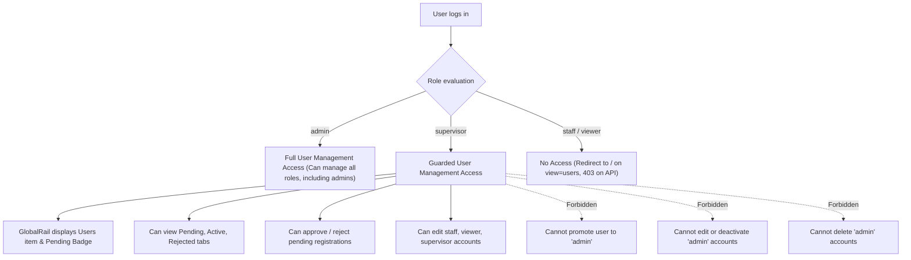

# Design Specification: Supervisor Guarded User Management Access

**Date:** 2026-11-02  
**Author:** Critical Senior Software Engineer (Pair Programmer)  
**Status:** Approved  
**Related Plan:** `docs/superpowers/plans/2026-11-02-supervisor-guarded-user-management.md`  
**ADR:** `docs/adr/0013-supervisor-guarded-user-management-access.md`  

---

## 1. Executive Summary

This specification formalizes **Guarded User Management Access** for the `supervisor` role in Vrello.

Previously, only `role === "admin"` had access to User Management (`/?view=users`) and its underlying administrative APIs (`/api/admin/users/*`). Supervisors—who act as regional operational leaders—needed the ability to approve pending registrations, assign operational branches, and manage staff/viewers, but were blocked by rigid `role === "admin"` checks.

This specification implements **Option 2 (Guarded Privilege)**:
- Grants `supervisor` full visibility to User Management and the pending badge on `GlobalRail`.
- Enables supervisors to review, approve (`APPROVED`), and reject (`REJECTED`) pending registrations.
- Enables supervisors to reassign branches and change roles between `supervisor`, `staff`, and `viewer`.
- **Guarded Constraints (Privilege Protection)**:
  - Supervisors cannot promote any user to `admin` (API rejects with HTTP 403).
  - Supervisors cannot modify (role, status, branches) or deactivate any `admin` user account (API rejects with HTTP 403).
  - Supervisors cannot delete any `admin` user account (API rejects with HTTP 403).
  - The UI reflects these boundaries by disabling action buttons and hiding the `admin` option from role selection dropdowns for supervisor actors.

---

## 2. UX Flow & Access Matrix



### Role Management Permissions Matrix:

| Actor Role | Target: Admin | Target: Supervisor | Target: Staff | Target: Viewer | Can Assign Role: Admin |
|------------|---------------|-------------------|---------------|----------------|------------------------|
| **Admin** | Edit, Deactivate, Delete | Edit, Deactivate, Delete | Edit, Deactivate, Delete | Edit, Deactivate, Delete | **Yes** |
| **Supervisor** | **Read-only (No Edit/Delete)** | Edit, Deactivate, Delete | Edit, Deactivate, Delete | Edit, Deactivate, Delete | **No (403)** |
| **Staff / Viewer** | Forbidden | Forbidden | Forbidden | Forbidden | Forbidden |

---

## 3. Pure Logic Signatures (`src/lib/marcom/guards.ts`)

```typescript
/**
 * Evaluates whether a user role has access to the User Management page and endpoints.
 * Returns true for "admin" and "supervisor".
 */
export function canAccessUserManagement(role?: string | null): boolean;

/**
 * Evaluates whether an actor role can manage (edit status, role, branches or delete) a target user.
 * - Admin can manage anyone (subject to self-protection).
 * - Supervisor can manage supervisor, staff, viewer, but CANNOT manage admin.
 */
export function canManageUserTarget(
  actorRole: string | null | undefined,
  targetRole: string | null | undefined
): boolean;

/**
 * Evaluates whether an actor role can assign a specific role.
 * - Admin can assign any role ("admin", "supervisor", "staff", "viewer").
 * - Supervisor can assign "supervisor", "staff", "viewer", but CANNOT assign "admin".
 */
export function canAssignUserRole(
  actorRole: string | null | undefined,
  newRole: string
): boolean;
```

---

## 4. API Endpoint Contracts

### `GET /api/admin/users` & `GET /api/admin/users/[id]`
- Authorization: `canAccessUserManagement(session.user.role)`
- Non-admin/non-supervisor returns `403 Forbidden`.

### `PATCH /api/admin/users/[id]`
- Authorization: `canAccessUserManagement(session.user.role)`
- If target user has role `ADMIN`:
  - If `!canManageUserTarget(session.user.role, targetUser.role)`: returns `403 Forbidden` (`Supervisor tidak diizinkan mengubah akun Administrator.`).
- If request attempts to assign `role: "admin"`:
  - If `!canAssignUserRole(session.user.role, role)`: returns `403 Forbidden` (`Supervisor tidak diizinkan memberikan role Administrator.`).

### `DELETE /api/admin/users/[id]`
- Authorization: `canAccessUserManagement(session.user.role)`
- If target user has role `ADMIN`:
  - If `!canManageUserTarget(session.user.role, targetUser.role)`: returns `403 Forbidden` (`Supervisor tidak diizinkan menghapus akun Administrator.`).

---

## 5. UI Integration

1. **`GlobalRail.tsx`**:
   - `const canManageUsers = canAccessUserManagement(session?.user?.role);`
   - Render `Users` nav item and pending badge if `canManageUsers`.
2. **`ActiveViewStage.tsx`**:
   - Authorize `UsersView` when `canAccessUserManagement(session?.user?.role)`.
3. **`AdminUsersPage` (`src/app/admin/users/page.tsx`)**:
   - Authorize when `canAccessUserManagement(session.user.role)`.
4. **`UserRoleSelect.tsx`**:
   - Exclude `Admin` option when actor is `supervisor`.
   - Disable component when target is `admin` and actor is `supervisor`.
5. **`UsersActiveTab.tsx` & `UsersRejectedTab.tsx`**:
   - Disable Deactivate and Delete buttons on `admin` rows when actor is `supervisor`.

---

## 6. Acceptance Criteria

- [ ] Supervisor can access `/?view=users` and see the `Users` nav item in `GlobalRail`.
- [ ] Supervisor sees the red dot pending badge in `GlobalRail` when registrations are awaiting review.
- [ ] Supervisor can approve and reject pending registrations.
- [ ] Supervisor can edit roles for staff, viewer, and supervisor.
- [ ] Supervisor cannot assign `admin` role (API responds 403, UI excludes `Admin`).
- [ ] Supervisor cannot edit, deactivate, or delete an `admin` account (API responds 403, UI disables actions).
- [ ] Admins retain full unrestricted management over all accounts.
- [ ] Non-management roles (`staff`, `viewer`) receive 403 on API and are redirected from `/admin/users` and `/?view=users`.
- [ ] All verification gates pass: `npm run drift:check`, `npm test`, `npm run build:check`.

