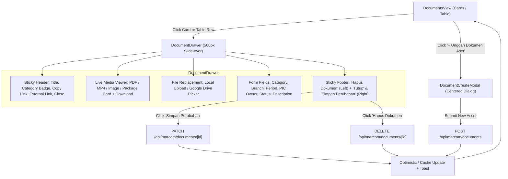

# Specification: Documents Detail & Edit Drawer with Focused Creation Modal

## Status
ACCEPTED (ADR-0024)

## Date
2026-11-05

## 1. Executive Summary
This specification defines the transformation of the Documents & Asset Library (`DocumentItem`) user interface from fragmented, centered modal dialogs into a unified slide-over detail drawer (`DocumentDrawer.tsx`) paired with a focused kickoff modal dialog (`DocumentCreateModal.tsx`).

This establishes 100% architectural and interaction parity with Content Planner (`ContentDrawer.tsx`) and Field Events (`EventDrawer.tsx`, ADR-0022). Users can simultaneously inspect file contents (PDF, MP4, images, office/archives) and edit metadata without modal thrashing.

---

## 2. Problem Statement & User Experience Objectives

### Current Friction
- **Fragmented Modal Hopping**: Clicking a document card opens `DocumentPreviewModal.tsx`. Clicking the edit icon closes the preview and opens an inline modal dialog (`modalDocument` in `DocumentsView.tsx`). Users cannot view the document preview while editing its description or metadata.
- **Inconsistent Interaction Standard**: Content Planner and Field Events both utilize a 560px wide slide-over right drawer. Documents remains the only core operational module using stacked centered dialogs.
- **Coordinator Complexity**: `DocumentsView.tsx` spans 809 lines containing inline form state, upload listeners, preview modal bindings, and view switching.

### Target Experience
1. **Single-Click Drawer**: Clicking any document card in `DocumentCardsView` or table row in `DocumentsView` smoothly slides open `DocumentDrawer` from the right edge.
2. **Cohesive Preview & Edit**: The document's media viewer, download actions, file replacement controls, and metadata fields live together in a single scrollable container.
3. **Dedicated Create Kickoff**: Clicking "+ Unggah Dokumen Aset" opens a centered modal dialog (`DocumentCreateModal.tsx`) optimized for fast kickoff.
4. **Context Preservation**: The underlying table or cards grid remains visible behind a soft backdrop blur, preserving user orientation.

---

## 3. End-to-End User Flow



---

## 4. Component Architecture & Responsibilities

### 4.1 `DocumentDrawer.tsx` (`src/components/views/DocumentsView/DocumentDrawer.tsx`)
- **Props Contract**:
  ```typescript
  interface DocumentDrawerProps {
    document: MarcomDocument | null;
    onClose: () => void;
    onUpdateDocument: (updated: MarcomDocument) => Promise<void> | void;
    onDeleteDocument: (id: string) => Promise<void> | void;
    branches: { id: string; name: string }[];
    members: User[];
    canManage: boolean;
  }
  ```
- **Motion & Shell**:
  - `motion.aside`: `initial={{ x: "100%" }} animate={{ x: 0 }} exit={{ x: "100%" }} transition={{ type: "spring", damping: 28, stiffness: 300 }}`.
  - Dimensions: `w-full sm:w-[560px] h-full bg-white dark:bg-[#18191B] border-l border-slate-200 dark:border-slate-800 shadow-2xl flex flex-col`.
  - Backdrop: `motion.div` with `bg-slate-950/40 backdrop-blur-xs fixed inset-0 z-40`.
- **Header Elements**:
  - Category badge & File type chip (`getDocumentTypeMeta(fileType)`).
  - Inline editable title: `<input value={name} onChange={...} />` with hover/focus border.
  - Quick action bar:
    - `<Copy />` button: copies `filePath` to clipboard with success toast.
    - `<ExternalLink />` anchor: opens `filePath` in new browser tab.
    - `<X />` button: closes drawer.
- **Body Sections**:
  - **1. Live Media Preview**:
    - Drive Embed / Office: `<iframe>` if valid embed URL.
    - Video (MP4): Native `<video controls className="w-full max-h-[360px] rounded-xl bg-black" />`.
    - Image (PNG/JPG): `<AppImage src={filePath} fill sizes="lightbox" className="object-contain" />`.
    - PDF: Embedded `<iframe src={filePath} className="w-full h-[420px] rounded-xl border border-slate-200 dark:border-slate-800" />`.
    - ZIP / CSV / Other: Card package box with icon, file size, description, and primary "Download / Buka Dokumen" button.
  - **2. File Replacement Control**:
    - Sub-bar allowing user to re-upload from local disk (via `/api/marcom/uploads`) or link a Google Drive URL, automatically updating `filePath`, `fileType`, and `fileSizeMb`.
  - **3. Metadata Form (Grey Card Container)**:
    - Kategori Dokumen (text input / select).
    - Status Dokumen: `<select>` (`ACTIVE`, `DRAFT`, `ARCHIVED`).
    - Wilayah / Branch: `<select>` populated from `branches`.
    - Periode Dokumen: Text input (e.g. `2026`, `Q3 2026`).
    - PIC / Owner: Member select matching `members` with custom fallback.
    - Catatan / Deskripsi: Auto-resizing `<textarea rows={3} />`.
- **Footer Elements**:
  - Left: "Hapus Dokumen" (`<Trash2 />`, text-rose-500 hover:bg-rose-50) with `confirm()` guard, calling `onDeleteDocument(document.id)`.
  - Right: "Tutup" (`onClose`) and "Simpan Perubahan" primary button with loading spinner, calling `onUpdateDocument(updatedData)`.

### 4.2 `DocumentCreateModal.tsx` (`src/components/views/DocumentsView/DocumentCreateModal.tsx`)
- **Props Contract**:
  ```typescript
  interface DocumentCreateModalProps {
    isOpen: boolean;
    onClose: () => void;
    onCreated: (doc: MarcomDocument) => void;
    branches: { id: string; name: string }[];
    members: User[];
  }
  ```
- **Form Fields**:
  - Document Name, Category, Branch, PIC Owner, File Upload (local or Drive link), Period, and Description.
  - Validates required fields (`name`, `category`, `fileType`, `filePath`).
  - Calls `POST /api/marcom/documents`, invokes `onCreated(resJson)`, and closes modal.

### 4.3 `DocumentsView.tsx` Coordinator Clean-up
- Deprecate inline modal state:
  ```typescript
  // OLD
  const [modalDocument, setModalDocument] = useState<Partial<MarcomDocument> | null>(null);
  const [previewDocument, setPreviewDocument] = useState<MarcomDocument | null>(null);

  // NEW
  const [selectedDrawerDoc, setSelectedDrawerDoc] = useState<MarcomDocument | null>(null);
  const [isCreateModalOpen, setIsCreateModalOpen] = useState(false);
  ```
- Connect card click in `DocumentCardsView` and row click in `MarcomTableShell` to `setSelectedDrawerDoc(doc)`.
- Mount `<AnimatePresence>{selectedDrawerDoc && <DocumentDrawer ... />}</AnimatePresence>`.
- Mount `<DocumentCreateModal isOpen={isCreateModalOpen} onClose={() => setIsCreateModalOpen(false)} ... />`.
- Remove `DocumentPreviewModal.tsx` and legacy inline `<form>` from `DocumentsView.tsx`.

---

## 5. Data Contracts & System Invariants

### 5.1 SSoT Entity Alignment
All document records strictly conform to `DocumentItem` from `src/types/index.ts`:
```typescript
export interface DocumentItem {
  id: string;
  name: string;
  category: string;
  period?: string;
  branchName?: string;
  ownerPic?: string;
  status?: DocumentStatus; // "DRAFT" | "ACTIVE" | "ARCHIVED"
  fileType: DocFileType | string;
  fileSizeMb?: number;
  filePath: string;
  description?: string;
}
```

### 5.2 API Contracts (Preserved 100%)
- **`GET /api/marcom/documents`**: Returns `{ total: number, data: DocumentItem[] }`.
- **`POST /api/marcom/documents`**: Creates new record, validates `filePath` via `isValidDocumentFilePath(filePath)`.
- **`PATCH /api/marcom/documents/[id]`**: Updates metadata and optional replacement `filePath`.
- **`DELETE /api/marcom/documents/[id]`**: Removes document record.

### 5.3 Storage & File Path Rules
- `filePath` must satisfy `isValidDocumentFilePath`:
  - Either `/api/marcom/files/...` (internal servable path without directory traversal), OR
  - Valid `https://` / `http://` URL (Google Drive preview or cloud storage).

---

## 6. Failure Modes & Operational Resilience

| Failure Mode | Impact | Mitigation |
| :--- | :--- | :--- |
| **Network Timeout on File Replace** | File upload fails mid-way | Show error toast via Sonner; preserve prior `filePath` and do not corrupt existing document record. |
| **Iframe Sandbox / Embed Block** | External provider blocks embedding in iframe | Provide prominent fallback button: "Buka file di tab baru" (`<ExternalLink />`) and "Download Dokumen" (`<Download />`). |
| **Concurrent Mutation** | Another operator deletes the document while open | API returns 404 on PATCH/DELETE; drawer displays notification toast and cleanly closes itself, updating parent table state. |
| **Unsaved Changes on Escape** | User presses `Esc` with dirty form fields | Close drawer gracefully; standard non-destructive navigation. |

---

## 7. Verification Checklist & Acceptance Criteria

### Automated Testing
- [ ] New unit test file `src/components/views/DocumentsView/documentDrawer.test.ts`:
  - Asserts `DocumentDrawer.tsx` exists and contains sticky header, media preview, metadata form, and footer actions.
  - Asserts `DocumentCreateModal.tsx` exists and handles document creation.
  - Asserts `DocumentPreviewModal.tsx` is decommissioned/removed.
  - Asserts `DocumentsView.tsx` wires `selectedDrawerDoc` to card clicks and table row clicks.
  - Asserts coordinator size of `DocumentsView.tsx` is reduced significantly.

### Manual Verification
- [ ] Clicking a document card in cards view opens `DocumentDrawer`.
- [ ] Clicking a document table row in table view opens `DocumentDrawer`.
- [ ] PDF, MP4, PNG, and ZIP documents render appropriate preview viewer inside the drawer.
- [ ] Modifying Title, Category, Branch, PIC, or Description and clicking "Simpan Perubahan" persists successfully.
- [ ] Clicking "Hapus Dokumen" deletes the asset after confirmation.
- [ ] Clicking "+ Unggah Dokumen Aset" opens `DocumentCreateModal`.
- [ ] `npm run drift:check` passes with 0 drift.
- [ ] `npm run build:check` passes with 0 compilation errors.
- [ ] `npm test` passes with 0 test failures.


