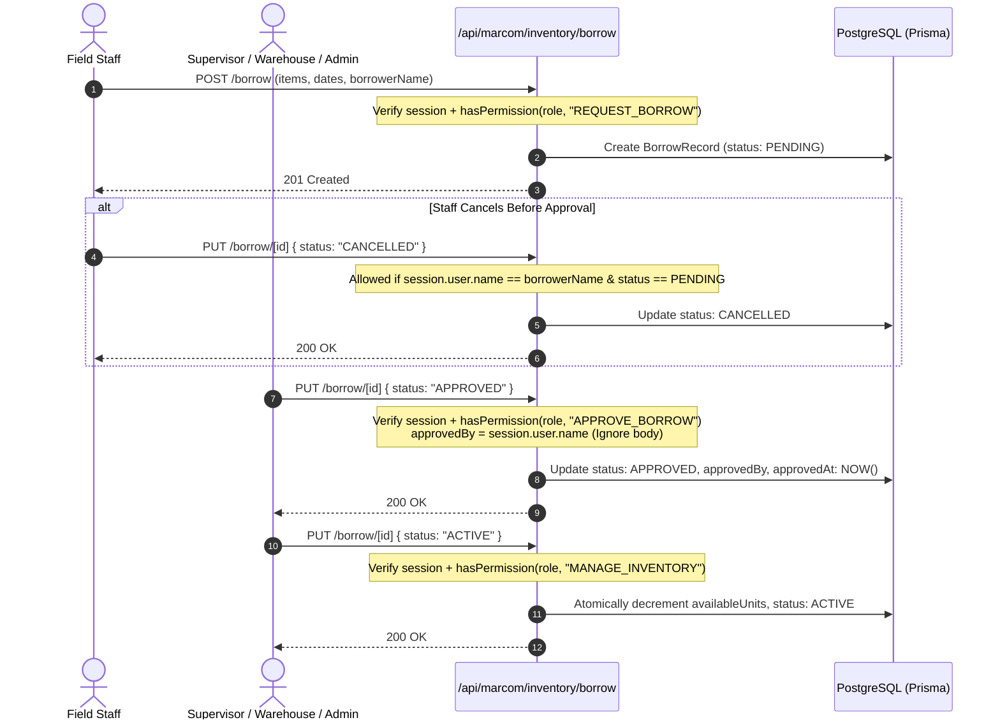

# Design Spec: Inventory Borrow Server-Side RBAC Guard & Audit Integrity

- **Date:** 2026-11-10
- **Status:** APPROVED
- **Author:** Senior Software Engineer & Principal Systems Architect
- **Target ADR:** [ADR-0100](../../adr/0100-inventory-borrow-server-side-rbac-and-audit-integrity.md)

---

## 1. Executive Summary

This specification locks down server-side authentication and role-based access control (RBAC) across the inventory borrowing lifecycle endpoints (`POST /api/marcom/inventory/borrow` and `PUT /api/marcom/inventory/borrow/[id]`). It resolves a critical security vulnerability where non-privileged roles (`staff`, `viewer`) can bypass the frontend UI to approve borrow requests, initiate physical stock deductions (`ACTIVE`), and spoof auditor identity via client-supplied `approvedBy` parameters.

All transitions are strictly bound to verified NextAuth server sessions and the central permission registry (`src/lib/marcom/guards.ts`). Approver identity is derived strictly from server-side session claims, establishing non-repudiation and restoring audit log fidelity.

---

## 2. End-to-End Flow & Stakeholders



---

## 3. State Machine & RBAC Transition Matrix

### Transition Guards

| Current Status | Target Status | Required Permission | Allowed Roles | Identity / Side Effect |
| :--- | :--- | :--- | :--- | :--- |
| *(None)* | `PENDING` (`POST`) | `REQUEST_BORROW` | `admin`, `supervisor`, `warehouse`, `staff` | Creates record with `status: PENDING`. |
| `PENDING` | `APPROVED` (`PUT`) | `APPROVE_BORROW` | `admin`, `supervisor`, `warehouse` | `approvedBy` set strictly to `session.user.name \|\| session.user.email`. `approvedAt = new Date()`. |
| `APPROVED` | `ACTIVE` (`PUT`) | `MANAGE_INVENTORY` | `admin`, `supervisor`, `warehouse` | Atomically checks availability and decrements `availableUnits`. |
| `PENDING` | `CANCELLED` (`PUT`) | `MANAGE_INVENTORY` OR Requester | Managers (`admin`, `supervisor`, `warehouse`) OR Requester matching `borrowerName` | Sets `status: CANCELLED`. No unit changes. |
| `APPROVED` | `CANCELLED` (`PUT`) | `MANAGE_INVENTORY` | `admin`, `supervisor`, `warehouse` | Sets `status: CANCELLED`. Unit availability unaffected. |
| Any | Metadata Edit (`PUT`) | `MANAGE_INVENTORY` OR Requester (when `PENDING`) | Managers (`admin`, `supervisor`, `warehouse`) OR Requester | Updates `notes`, `picName`, `purpose`, `eventLocation`. |
| `ACTIVE` / `OVERDUE` | `RETURNED` | *(Forbidden via `PUT`)* | N/A | Returns 422; must use `/return` endpoint. |

---

## 4. API Contracts & Failure Modes

### 4.1. `POST /api/marcom/inventory/borrow`
- **Headers:** Standard Cookie session or `x-user-role` (test runner only).
- **Responses:**
  - `401 Unauthorized`: `{ "error": "Unauthorized" }` when unauthenticated.
  - `403 Forbidden`: `{ "error": "Role does not have permission to request equipment borrowing." }` when `!hasPermission(role, "REQUEST_BORROW")`.
  - `400 Bad Request`: Validation failure on required fields.
  - `201 Created`: Returns newly created `BorrowRecord`.

### 4.2. `PUT /api/marcom/inventory/borrow/[id]`
- **Body Schema:**
  ```ts
  interface BorrowUpdateRequest {
    status?: "APPROVED" | "ACTIVE" | "CANCELLED";
    notes?: string;
    picName?: string;
    purpose?: string;
    eventLocation?: string;
    // approvedBy is intentionally ignored and discarded from body payload
  }
  ```
- **Responses:**
  - `401 Unauthorized`: When session cannot be resolved.
  - `403 Forbidden`:
    - On `status === "APPROVED"` when `!hasPermission(role, "APPROVE_BORROW")`.
    - On `status === "ACTIVE"` when `!hasPermission(role, "MANAGE_INVENTORY")`.
    - On `status === "CANCELLED"` when user is not a manager and does not match `borrowerName` on a `PENDING` record.
    - On metadata updates when caller is not a manager and does not match `borrowerName`.
  - `404 Not Found`: When record does not exist.
  - `422 Unprocessable Entity`: Invalid transition or insufficient units on pickup.
  - `200 OK`: Returns updated `BorrowRecord`.

---

## 5. Acceptance Criteria (Gherkin Scenarios)

### AC-1: Viewer Rejection on Borrow Creation
- **Given** an authenticated user with role `viewer`
- **When** calling `POST /api/marcom/inventory/borrow`
- **Then** the server responds with HTTP 403 and error message indicating insufficient permissions.

### AC-2: Staff / Viewer Rejection on Direct Approval
- **Given** an authenticated user with role `staff` or `viewer`
- **And** an existing `BorrowRecord` in `PENDING` state
- **When** calling `PUT /api/marcom/inventory/borrow/[id]` with `{ "status": "APPROVED" }`
- **Then** the server responds with HTTP 403
- **And** the record status remains `PENDING`.

### AC-3: Server-Derived `approvedBy` Enforcement
- **Given** an authenticated user "John Doe" with role `supervisor`
- **And** an existing `BorrowRecord` in `PENDING` state
- **When** calling `PUT /api/marcom/inventory/borrow/[id]` with `{ "status": "APPROVED", "approvedBy": "Fake Admin" }`
- **Then** the server responds with HTTP 200
- **And** the database record reflects `approvedBy: "John Doe"` (ignoring "Fake Admin")
- **And** `approvedAt` is set to the current server timestamp.

### AC-4: Staff Self-Cancellation on PENDING Request
- **Given** an authenticated user "Alice Smith" with role `staff`
- **And** an existing `BorrowRecord` with `borrowerName: "Alice Smith"` and `status: "PENDING"`
- **When** Alice calls `PUT /api/marcom/inventory/borrow/[id]` with `{ "status": "CANCELLED" }`
- **Then** the server responds with HTTP 200 and updates status to `CANCELLED`.

### AC-5: Staff Rejection on Cancelling Other Staff's Request
- **Given** an authenticated user "Bob Jones" with role `staff`
- **And** an existing `BorrowRecord` with `borrowerName: "Alice Smith"` and `status: "PENDING"`
- **When** Bob calls `PUT /api/marcom/inventory/borrow/[id]` with `{ "status": "CANCELLED" }`
- **Then** the server responds with HTTP 403.

### AC-6: Staff / Viewer Rejection on Direct Pickup (ACTIVE)
- **Given** an authenticated user with role `staff` or `viewer`
- **And** an existing `BorrowRecord` in `APPROVED` state
- **When** calling `PUT /api/marcom/inventory/borrow/[id]` with `{ "status": "ACTIVE" }`
- **Then** the server responds with HTTP 403
- **And** the inventory item's `availableUnits` is NOT decremented.

---

## 6. Non-Goals

1. **Foreign Key Migration:** No schema migration to alter `BorrowRecord.borrowerId` foreign key. Name matching (`borrowerName`) is used for current release to preserve schema stability.
2. **Stock Reservation Redesign:** Automatic locking of units during `APPROVED` state is out of scope (deferred to Temuan 4 tracking).
3. **Overdue Cron Automations:** Automated email/push alerts for overdue equipment are out of scope (deferred to Temuan 5 tracking).

---

## 7. Verification Checklist

- [ ] `npm run drift:check` passes with zero violations.
- [ ] Automated regression tests in `src/app/api/marcom/inventory/inventoryApi.test.ts` pass all existing scenarios.
- [ ] New automated security tests verify 401/403 rejections on unauthorized `POST` and `PUT`.
- [ ] Verification confirms `approvedBy` is set from session identity and body payload is ignored.
- [ ] `npm test` passes with 0 failures.
- [ ] `npm run build:check` passes with 0 errors.


