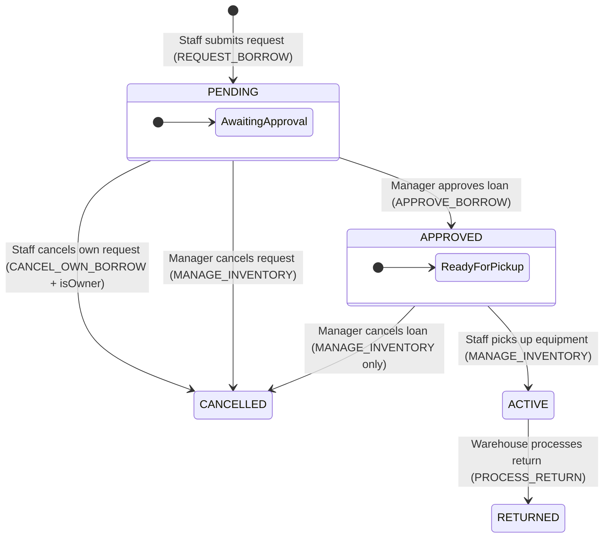

# Design Spec: Staff Self-Cancellation and CANCEL_OWN_BORROW RBAC Action

- **Date:** 2026-11-10
- **Status:** APPROVED
- **Author:** Senior Software Engineer & Principal Systems Architect
- **Target ADR:** [ADR-0101](../../adr/0101-staff-self-cancellation-and-cancel-own-borrow-rbac-action.md)

---

## 1. Executive Summary

This specification introduces the `CANCEL_OWN_BORROW` permission action into the centralized RBAC system (`src/lib/marcom/guards.ts`) and unlocks self-cancellation for Field Staff who have submitted equipment borrow requests that remain in `PENDING` status.

Previously, `BorrowDetailModal.tsx` restricted all cancellation actions behind `canManage` (`MANAGE_INVENTORY`). Because ADR-0050 revoked `MANAGE_INVENTORY` from `staff` to prevent unauthorized asset management, staff were blocked from cancelling their own unapproved requests. This design restores operational autonomy for field staff while preserving warehouse staging integrity by disallowing non-manager cancellation once a loan is `APPROVED`.

---

## 2. UX Flow & Lifecycle



---

## 3. Central Permission Specification (`src/lib/marcom/guards.ts`)

### 3.1. Type Definition Update
```ts
export type PermissionAction =
  | "CREATE_MOU" | "APPROVE_MOU" | "DELETE_MOU" | "CREATE_PLACEMENT"
  | "UPDATE_PLACEMENT" | "CREATE_EVENT" | "UPLOAD_VIDEO_FOOTAGE"
  | "UPLOAD_DOCUMENT" | "DELETE_DOCUMENT" | "MANAGE_MASTER_DATA" | "EXPORT_REPORTS"
  | "SUBMIT_DRAFT_OUTLET" | "APPROVE_OUTLET"
  | "VIEW_INVENTORY" | "MANAGE_INVENTORY" | "REQUEST_BORROW" | "APPROVE_BORROW" | "PROCESS_RETURN"
  | "CANCEL_OWN_BORROW";
```

### 3.2. Role Permission Mapping

| Role | `CANCEL_OWN_BORROW` | `MANAGE_INVENTORY` | Scope of Cancellation |
| :--- | :---: | :---: | :--- |
| `admin` | ✅ | ✅ | Can cancel any request in `PENDING` or `APPROVED`. |
| `supervisor` | ✅ | ✅ | Can cancel any request in `PENDING` or `APPROVED`. |
| `warehouse` | ✅ | ✅ | Can cancel any request in `PENDING` or `APPROVED`. |
| `staff` | ✅ | ❌ | Can cancel **ONLY own** request while in `PENDING`. |
| `viewer` | ❌ | ❌ | Read-only; cannot cancel any request. |

---

## 4. Component UI Specifications (`BorrowDetailModal.tsx`)

### 4.1. Session & Permission Integration
- Import `useSession` from `next-auth/react`.
- Import `useMarcomPermissions` from `@/lib/marcom/permissions`.
- Evaluate:
  ```tsx
  const { data: session } = useSession();
  const { can } = useMarcomPermissions();
  const canCancelOwn = can("CANCEL_OWN_BORROW");

  const isOwner = Boolean(
    session?.user?.name &&
    record.borrowerName.trim().toLowerCase() === session.user.name.trim().toLowerCase()
  );

  const canCancelPending = canManage || (canCancelOwn && isOwner);
  ```

### 4.2. Action Button Rendering Logic
- Replace the current `record.status === "PENDING" && canManage` condition with:
  ```tsx
  {record.status === "PENDING" && canCancelPending && (
    <button
      type="button"
      onClick={() => onStatusChange(record.id, "CANCELLED")}
      className="px-3 py-1.5 border border-rose-200 text-rose-600 hover:bg-rose-50 dark:border-rose-900 dark:hover:bg-rose-950/40 rounded-lg text-xs font-medium flex items-center gap-1"
    >
      <Ban className="w-3.5 h-3.5" />
      Cancel Request
    </button>
  )}
  ```
- Retain the existing `record.status === "APPROVED" && canManage` block unchanged for administrative "Cancel Loan".

---

## 5. Acceptance Criteria (Gherkin Scenarios)

### AC-1: Staff Can Cancel Own PENDING Request
- **Given** an authenticated user "Siti Rahma" with role `staff`
- **And** a borrow record with `borrowerName: "Siti Rahma"` and `status: "PENDING"`
- **When** Siti opens `BorrowDetailModal`
- **Then** the "Cancel Request" button is visible and clickable
- **And** clicking it triggers `onStatusChange(record.id, "CANCELLED")`.

### AC-2: Staff Cannot Cancel Other Staff's PENDING Request
- **Given** an authenticated user "Budi Santoso" with role `staff`
- **And** a borrow record with `borrowerName: "Siti Rahma"` and `status: "PENDING"`
- **When** Budi opens `BorrowDetailModal`
- **Then** the "Cancel Request" button is NOT rendered.

### AC-3: Staff Cannot Cancel APPROVED Loan
- **Given** an authenticated user "Siti Rahma" with role `staff`
- **And** a borrow record with `borrowerName: "Siti Rahma"` and `status: "APPROVED"`
- **When** Siti opens `BorrowDetailModal`
- **Then** neither "Cancel Request" nor "Cancel Loan" button is rendered.

### AC-4: Warehouse / Supervisor / Admin Can Cancel Any PENDING or APPROVED Loan
- **Given** an authenticated user with role `warehouse`, `supervisor`, or `admin`
- **And** a borrow record with any `borrowerName`
- **When** the manager opens `BorrowDetailModal`
- **Then** "Cancel Request" is rendered when status is `PENDING`
- **And** "Cancel Loan" is rendered when status is `APPROVED`.

### AC-5: Viewer Cannot Cancel Any Loan
- **Given** an authenticated user with role `viewer`
- **When** viewing any borrow record in `BorrowDetailModal`
- **Then** no cancellation buttons are ever rendered.

---

## 6. Non-Goals

1. **Database Schema Alteration:** No migration to add `createdById` to `BorrowRecord`.
2. **Post-Approval Staff Cancellation:** No mechanism for staff to bypass warehouse authority once status reaches `APPROVED`.
3. **Modal Redesign:** No structural redesign of `BorrowDetailModal.tsx` layout or theme styles.

---

## 7. Verification Checklist

- [ ] `npm run drift:check` passes with zero violations.
- [ ] `src/lib/marcom/guards.test.ts` verifies `CANCEL_OWN_BORROW` assignments across all 5 roles.
- [ ] Unit tests for `BorrowDetailModal` verify rendering behavior for owner staff, non-owner staff, managers, and viewers across `PENDING` and `APPROVED` states.
- [ ] Full regression test suite passes with 0 failures (`npm test`).
- [ ] TypeScript compilation succeeds with 0 errors (`npm run build:check`).


