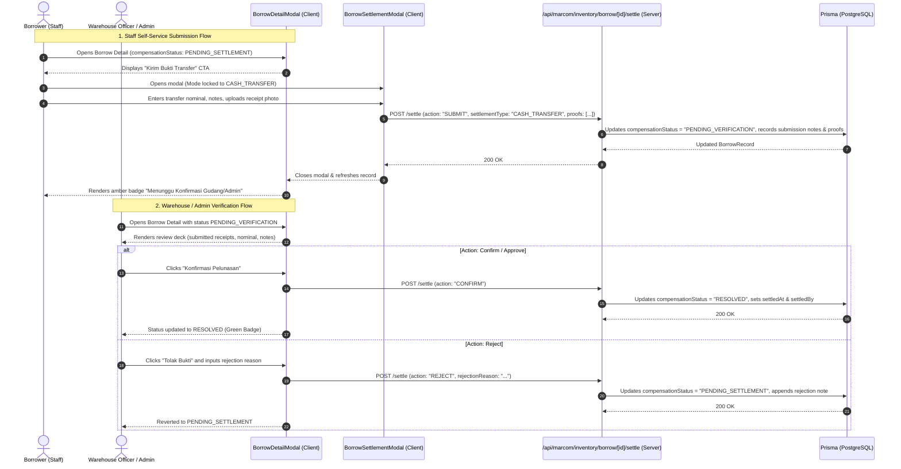

# Design Spec: Hybrid Staff Cash Settlement Submission and Warehouse Verification

- **Date:** 2026-11-11
- **Status:** APPROVED
- **Author:** Senior Software Engineer & Principal Systems Architect
- **Target ADR:** [ADR-0106](../../adr/0106-hybrid-staff-cash-settlement-submission-and-warehouse-verification.md)

---

## 1. Executive Summary & End-to-End User Flow

This specification establishes a secure, asynchronous self-service liability settlement submission workflow for field marketing personnel (`staff`) settling equipment damage or afkir compensation via bank transfer (`CASH_TRANSFER`), while maintaining an airtight physical verification guard for physical item replacements (`ITEM_REPLACEMENT`) in accordance with the Four-Eyes Principle ([ADR-0050](../../adr/0050-warehouse-role-and-return-inspection-compensation-workflow.md), [ADR-0052](../../adr/0052-inventory-compensation-settlement-and-restoration-workflow.md), and [ADR-0106](../../adr/0106-hybrid-staff-cash-settlement-submission-and-warehouse-verification.md)).

### 1.1. End-to-End User Flow


---

## 2. State Machine & Transition Invariants

### 2.1. Valid Status Enum
The `compensationStatus` property on `BorrowRecord` supports four canonical states:
1. `"NONE"`: Initial state when no afkir/damage is recorded during equipment return.
2. `"PENDING_SETTLEMENT"`: Equipment was returned with damage/loss (`majorDamageUnits > 0` or `lostUnits > 0`); liability is pending resolution or a previous submission was rejected.
3. `"PENDING_VERIFICATION"`: The borrower has submitted a bank transfer payment receipt; awaiting warehouse/admin review.
4. `"RESOLVED"`: Payment verified by warehouse/admin or physical replacement item received and catalog stock restored.

### 2.2. State Transition Matrix & Guard Invariants
| From State | Event / Action | Actor | Target State | Guard Conditions |
| :--- | :--- | :--- | :--- | :--- |
| `NONE` | Equipment Return with afkir | Warehouse / Admin | `PENDING_SETTLEMENT` | `majorDamageUnits > 0 \|\| lostUnits > 0` |
| `PENDING_SETTLEMENT` | Staff Cash Submission (`action: "SUBMIT"`) | Borrower (`staff`) or Warehouse/Admin | `PENDING_VERIFICATION` | `settlementType === "CASH_TRANSFER"`, `proofs.length >= 1`, non-empty notes |
| `PENDING_SETTLEMENT` | Direct On-the-Spot Settle (`action: "DIRECT_RESOLVE"`) | Warehouse / Admin | `RESOLVED` | `hasPermission(role, "PROCESS_RETURN")` (Supports both `CASH_TRANSFER` & `ITEM_REPLACEMENT`) |
| `PENDING_VERIFICATION` | Verification Confirm (`action: "CONFIRM"`) | Warehouse / Admin | `RESOLVED` | `hasPermission(role, "PROCESS_RETURN")`, sets `settledBy` and `settledAt` |
| `PENDING_VERIFICATION` | Verification Reject (`action: "REJECT"`) | Warehouse / Admin | `PENDING_SETTLEMENT` | `hasPermission(role, "PROCESS_RETURN")`, requires non-empty `rejectionReason` |

> [!IMPORTANT]
> **Strict Anti-Phantom Inventory Invariant:**  
> A borrower with role `staff` is **strictly forbidden** from invoking `action: "SUBMIT"` with `settlementType: "ITEM_REPLACEMENT"`. Physical equipment replacements can ONLY be processed directly by `warehouse` or `admin` at the counter via `action: "DIRECT_RESOLVE"`.

---

## 3. Backend API Contract (`POST /api/marcom/inventory/borrow/[id]/settle`)

### 3.1. Unified Endpoint Strategy
To maintain backward compatibility with existing integration tests and components while supporting the two-step verification lifecycle, `/api/marcom/inventory/borrow/[id]/settle` accepts an optional `action` parameter defaulting to `"DIRECT_RESOLVE"` when invoked by an officer with `PROCESS_RETURN`.

### 3.2. Payload Schema
```ts
export type SettlementAction = "SUBMIT" | "CONFIRM" | "REJECT" | "DIRECT_RESOLVE";

export interface SettleCompensationPayload {
  action?: SettlementAction; // Defaults to "DIRECT_RESOLVE" if caller has PROCESS_RETURN and status is PENDING_SETTLEMENT
  settlementType?: "CASH_TRANSFER" | "ITEM_REPLACEMENT";
  settledAmount?: number;
  settlementNotes?: string;
  settlementProofUrls?: string[];
  rejectionReason?: string; // Mandatory when action === "REJECT"
}
```

### 3.3. Execution Logic by Action

#### A. Action `"SUBMIT"` (Staff Self-Service Submission)
- **RBAC Check:** Caller must either be the borrower (`session.userName.trim().toLowerCase() === record.borrowerName.trim().toLowerCase()`) or possess `PROCESS_RETURN`.
- **Status Guard:** `record.compensationStatus === "PENDING_SETTLEMENT"`.
- **Mode Guard:** `settlementType` must strictly be `"CASH_TRANSFER"`. If `"ITEM_REPLACEMENT"`, reject with `HTTP 403 Forbidden` (`"Penggantian unit fisik wajib diserahkan dan diverifikasi langsung oleh petugas gudang"`).
- **Proof Guard:** `settlementProofUrls` must contain at least 1 valid URL (from `/api/marcom/uploads`).
- **Notes Guard:** `settlementNotes` must be a non-empty string.
- **Database Mutation:**
  - `compensationStatus = "PENDING_VERIFICATION"`
  - `settlementType = "CASH_TRANSFER"`
  - `settledAmount = settledAmountNum`
  - `settlementNotes = settlementNotes.trim()`
  - `settlementProofUrls = cleanProofUrls`
  - `settledBy = session.userName` (recorded as submitter)

#### B. Action `"CONFIRM"` (Warehouse/Admin Verification Approval)
- **RBAC Check:** Strictly requires `hasPermission(role, "PROCESS_RETURN")`. If caller is `staff` or `viewer`, reject with `HTTP 403 Forbidden`.
- **Status Guard:** `record.compensationStatus === "PENDING_VERIFICATION"`.
- **Database Mutation:**
  - `compensationStatus = "RESOLVED"`
  - `settledAt = new Date()`
  - `settledBy = session.userName` (recorded as final approver)

#### C. Action `"REJECT"` (Warehouse/Admin Verification Rejection)
- **RBAC Check:** Strictly requires `hasPermission(role, "PROCESS_RETURN")`.
- **Status Guard:** `record.compensationStatus === "PENDING_VERIFICATION"`.
- **Input Guard:** `rejectionReason` must be a non-empty string.
- **Database Mutation:**
  - `compensationStatus = "PENDING_SETTLEMENT"`
  - Appends rejection note to `settlementNotes`:  
    `"\n\n[DITOLAK ${session.userName} - ${new Date().toLocaleDateString('id-ID')}]: ${rejectionReason.trim()}"`

#### D. Action `"DIRECT_RESOLVE"` (Existing Fast-Path for Warehouse/Admin)
- **RBAC Check:** Strictly requires `hasPermission(role, "PROCESS_RETURN")`.
- **Status Guard:** `record.compensationStatus === "PENDING_SETTLEMENT"`.
- **Behavior:** Preserves 100% of existing ADR-0052 behavior (immediate `RESOLVED`, atomic stock increment on `ITEM_REPLACEMENT`, records `settledBy` and `settledAt`).

---

## 4. UI / UX Component Contracts

### 4.1. File: `src/components/views/InventoryView/BorrowDetailModal.tsx`
- **When `compensationStatus === "PENDING_SETTLEMENT"`:**
  - If user is `staff` and `isBorrower` (or has `PROCESS_RETURN`):
    - Renders action button: `"Kirim Bukti Pelunasan Transfer"` opening `BorrowSettlementModal`.
- **When `compensationStatus === "PENDING_VERIFICATION"`:**
  - Renders amber status badge: `"Menunggu Konfirmasi Gudang/Admin"`.
  - Displays submitted payment amount, notes, and uploaded transfer slips with preview.
  - If user has `PROCESS_RETURN` (`warehouse` / `admin`):
    - Renders `"Konfirmasi Pelunasan"` button (triggers `POST /settle` with `action: "CONFIRM"`).
    - Renders `"Tolak Bukti"` button (opens prompt or inline drawer for `rejectionReason`).
  - If user is `staff`:
    - Renders informative alert card: `"Bukti transfer telah dikirim dan sedang menunggu konfirmasi admin atau petugas gudang."`
- **When `compensationStatus === "RESOLVED"`:**
  - Renders green resolution card displaying resolution date, authorized by (`settledBy`), amount, notes, and proof links.

### 4.2. File: `src/components/views/InventoryView/BorrowSettlementModal.tsx`
- **Staff Mode vs Officer Mode:**
  - When opened by a `staff` user:
    - Mode toggle is locked to `"Pembayaran Kas / Transfer Bank"`.
    - `"Penggantian Barang Fisik"` toggle is disabled with descriptive helper text:  
      *"Penggantian unit fisik wajib diserahkan dan diverifikasi langsung di meja gudang oleh petugas warehouse."*
    - Primary CTA button reads: `"Kirim Pengajuan Pelunasan"` (dispatches `action: "SUBMIT"`).
  - When opened by an officer with `PROCESS_RETURN`:
    - Retains dual-mode toggle (`CASH_TRANSFER` vs `ITEM_REPLACEMENT`).
    - Primary CTA button reads: `"Selesaikan & Verifikasi Pelunasan"` (dispatches `action: "DIRECT_RESOLVE"`).

---

## 5. Acceptance Criteria (Gherkin Scenarios)

### AC-1: Staff Submits Cash Transfer Proof
- **Given** an officer returned equipment with `compensationStatus = "PENDING_SETTLEMENT"`
- **And** the current session user is `staff` and matches `borrowRecord.borrowerName`
- **When** the staff opens `BorrowSettlementModal`, uploads a transfer receipt, and clicks `"Kirim Pengajuan Pelunasan"`
- **Then** `POST /api/marcom/inventory/borrow/[id]/settle` is called with `action: "SUBMIT"` and `settlementType: "CASH_TRANSFER"`
- **And** `compensationStatus` transitions to `"PENDING_VERIFICATION"`
- **And** the status badge in `BorrowDetailModal` updates to `"Menunggu Konfirmasi Gudang/Admin"`.

### AC-2: Staff Prohibited from Physical Item Replacement Submission
- **Given** the current session user is `staff`
- **When** the staff views the settlement modal or sends a direct API request with `settlementType: "ITEM_REPLACEMENT"`
- **Then** the UI disables the physical replacement toggle
- **And** the backend rejects the request with `HTTP 403 Forbidden` (`"Penggantian unit fisik wajib diserahkan dan diverifikasi langsung oleh petugas gudang"`).

### AC-3: Warehouse/Admin Confirms Submitted Proof
- **Given** a `BorrowRecord` has `compensationStatus = "PENDING_VERIFICATION"`
- **And** the current session user has role `warehouse` or `admin`
- **When** the officer clicks `"Konfirmasi Pelunasan"`
- **Then** `POST /api/marcom/inventory/borrow/[id]/settle` is called with `action: "CONFIRM"`
- **And** `compensationStatus` transitions to `"RESOLVED"`
- **And** `settledBy` is updated with the reviewer's user name.

### AC-4: Warehouse/Admin Rejects Submitted Proof
- **Given** a `BorrowRecord` has `compensationStatus = "PENDING_VERIFICATION"`
- **And** the current session user has role `warehouse` or `admin`
- **When** the officer clicks `"Tolak Bukti"` and enters rejection reason `"Bukti buram"`
- **Then** `POST /api/marcom/inventory/borrow/[id]/settle` is called with `action: "REJECT"` and `rejectionReason: "Bukti buram"`
- **And** `compensationStatus` reverts to `"PENDING_SETTLEMENT"`
- **And** the rejection reason is appended to `settlementNotes`.

### AC-5: In-Person Direct Resolution Unaffected
- **Given** a `BorrowRecord` has `compensationStatus = "PENDING_SETTLEMENT"`
- **And** the officer has role `warehouse`
- **When** the officer settles compensation at the counter
- **Then** the record transitions directly to `RESOLVED` in 1 step without passing through `PENDING_VERIFICATION`.

---

## 6. Non-Negotiable Verification Gates

1. **Drift Check:** `npm run drift:check` (133/133 spec-plan pairs valid, coordinator files $\le 250$ LOC).
2. **Build Check:** `npm run build:check` (0 TypeScript / Next.js errors).
3. **Automated Tests:** `npm test` (0 failures across all suites).


