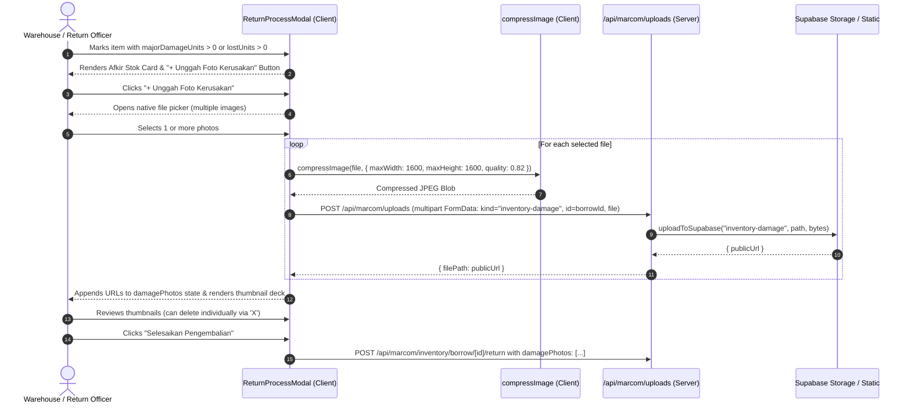

# Design Spec: Multi-Photo Direct Upload for Inventory Damage Inspection

- **Date:** 2026-11-11
- **Status:** APPROVED
- **Author:** Senior Software Engineer & Principal Systems Architect
- **Target ADR:** [ADR-0105](../../adr/0105-multi-photo-direct-upload-for-inventory-damage-inspection.md)

---

## 1. Executive Summary & Operational Flow

This specification defines the multi-photo direct upload mechanism for equipment damage inspection during asset returns in [`ReturnProcessModal.tsx`](file:///Users/mac/Web%20Development/vrello-up/src/components/views/InventoryView/ReturnProcessModal.tsx). It completely eliminates the passive URL input field and replaces it with an active device file picker supporting batch multi-image selection, client-side downsampling/compression, and secure persistent upload to `/api/marcom/uploads`.

### 1.1. End-to-End User Flow


---

## 2. Component Contract & UI State

### 2.1. File: `src/components/views/InventoryView/ReturnProcessModal.tsx`

#### Removed State
- `photoInputUrl`: Completely removed.

#### Added State
- `isUploading: boolean`: Tracks active batch upload progress.
- `uploadStatus: string`: Informs user of current progress (e.g. `"Mengunggah foto 2 dari 5..."`).
- `fileInputRef = useRef<HTMLInputElement>(null)`: Triggers hidden file picker.

#### Handler Algorithm: `handleFileSelect(e: React.ChangeEvent<HTMLInputElement>)`
1. Extract `files = Array.from(e.target.files || [])`.
2. Reset file input value (`e.target.value = ""`) so the same file can be re-selected if needed.
3. Validate each file is an image (`file.type.startsWith("image/")`). Warn via `toast.error` if a non-image file is chosen.
4. Set `isUploading = true`.
5. Iterate sequentially over files:
   - Update `uploadStatus = "Mengunggah foto X dari Y..."`.
   - Compress image via `compressImage(file, { maxWidth: 1600, maxHeight: 1600, quality: 0.82 })`.
   - Build `FormData`:
     - `formData.append("kind", "inventory-damage")`
     - `formData.append("id", record.id)`
     - `formData.append("file", compressed)`
   - Post to `/api/marcom/uploads`.
   - On success: push `data.filePath` into `damagePhotos`.
6. On loop complete: `toast.success("${N} foto berhasil diunggah")`.
7. In `finally`: `setIsUploading(false); setUploadStatus("");`.

#### Thumbnail Grid Deck
- Each image in `damagePhotos` is rendered as a `w-16 h-16` preview card with a hover/tap delete button.
- A "+ Tambah Foto" button remains visible alongside the thumbnails if more photos need to be appended.

---

## 3. Backend API Contract (`/api/marcom/uploads/route.ts`)

### 3.1. Extend `VALID_KINDS`
Update `VALID_KINDS` to include both `"inventory-damage"` and `"inventory-proofs"`:
```ts
const VALID_KINDS = [
  "documents",
  "mou-documents",
  "placements",
  "outlets",
  "inventory-damage",
  "inventory-proofs",
] as const;
```

### 3.2. Map Bucket & Prefix
```ts
const BUCKET_MAP: Record<UploadKind, string> = {
  documents: "marcom-documents",
  "mou-documents": "mou-documents",
  placements: "placement-photos",
  outlets: "outlet-photos",
  "inventory-damage": "inventory-damage",
  "inventory-proofs": "inventory-damage",
};

const KIND_PREFIX: Record<UploadKind, string> = {
  documents: "documents",
  "mou-documents": "mou-documents",
  placements: "placements",
  outlets: "outlets",
  "inventory-damage": "damage",
  "inventory-proofs": "settlement",
};
```

### 3.3. Authorization Guard
```ts
const PERMISSION_MAP: Record<UploadKind, string> = {
  documents: "UPLOAD_DOCUMENT",
  "mou-documents": "UPLOAD_DOCUMENT",
  placements: "CREATE_PLACEMENT",
  outlets: "SUBMIT_DRAFT_OUTLET",
  "inventory-damage": "PROCESS_RETURN",
  "inventory-proofs": "PROCESS_RETURN",
};
```
This ensures callers with `PROCESS_RETURN` permissions (`warehouse`, `supervisor`, `admin`) can upload physical damage proof and compensation settlement receipts without escalating general document permissions.

---

## 4. Acceptance Criteria (Gherkin Scenarios)

### AC-1: Native File Picker Trigger
- **Given** an officer is returning equipment with `majorDamageUnits >= 1`
- **When** the officer clicks `+ Unggah Foto Bukti`
- **Then** the native OS/browser file selection dialog opens with `accept="image/*"` and `multiple` enabled.

### AC-2: Batch Multi-File Upload & Thumbnail Deck
- **Given** an officer selects 3 images in the file picker
- **When** file selection confirms
- **Then** each image is compressed and sequentially uploaded to `/api/marcom/uploads`
- **And** 3 thumbnail cards are rendered in the Afkir Stok card with preview and delete buttons.

### AC-3: Incremental Additions
- **Given** 2 photos are already uploaded in the deck
- **When** the officer clicks the `+` upload button and selects 1 additional photo
- **Then** the third photo is uploaded and appended without clearing the first 2 photos (`total = 3`).

### AC-4: Removal of Photo
- **Given** 3 photos in the deck
- **When** the officer clicks the delete button on photo #2
- **Then** that photo is removed from `damagePhotos` state (`total = 2`).

### AC-5: Zero URL Input / Zero Silent Failure
- **Given** the Afkir Stok card is displayed
- **Then** no passive text URL input or `https://...` placeholder is rendered
- **And** all photo additions are performed via active file upload.


