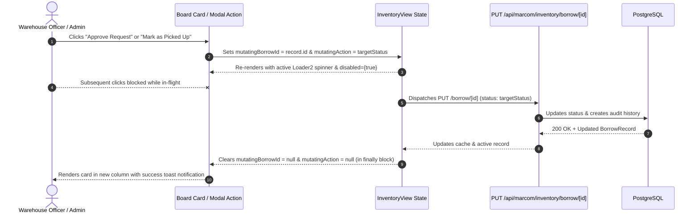

# Design Spec: Inventory Borrow Lifecycle Button Loaders and Mutation Guards

- **Date:** 2026-11-12
- **Status:** APPROVED
- **Author:** Senior Software Engineer & Principal Systems Architect
- **Target ADR:** [ADR-0107](../../adr/0107-inventory-borrow-lifecycle-button-loaders-and-mutation-guards.md)

---

## 1. Executive Summary & User Flow

This specification establishes localized asynchronous visual feedback and concurrency guards for equipment borrowing status progression buttons across the Equipment Inventory management module ([ADR-0107](../../adr/0107-inventory-borrow-lifecycle-button-loaders-and-mutation-guards.md)). It eliminates double submissions, rage clicking, and operational ambiguity by providing explicit inline spinners (`Loader2`) and click-locks (`disabled`) during network roundtrips.

### 1.1. User Flow Diagram


---

## 2. Component Contracts & State Architecture

### 2.1. State Controller: `src/components/views/InventoryView/InventoryView.tsx`
`InventoryView` serves as the coordinator holding the authoritative mutation state:
```ts
const [mutatingBorrowId, setMutatingBorrowId] = useState<string | null>(null);
const [mutatingAction, setMutatingAction] = useState<string | null>(null);
```

#### Mutation Handler Contract:
```ts
const handleStatusChange = async (id: string, newStatus: BorrowStatus) => {
  if (mutatingBorrowId) return; // Concurrency guard
  setMutatingBorrowId(id);
  setMutatingAction(newStatus);
  try {
    const res = await fetch(`/api/marcom/inventory/borrow/${id}`, {
      method: "PUT",
      headers: { "Content-Type": "application/json" },
      body: JSON.stringify({ status: newStatus }),
    });
    const data = await res.json();
    if (!res.ok) throw new Error(data.error || "Failed to update status");
    updateCachedBorrowRecord(data);
    if (selectedBorrow?.id === id) setSelectedBorrow(data);
    fetchInventory(true);
    toast.success(`Borrow request marked as ${newStatus}`);
  } catch (err: unknown) {
    toast.error(err instanceof Error ? err.message : "Update failed");
  } finally {
    setMutatingBorrowId(null);
    setMutatingAction(null);
  }
};
```

---

## 3. Interaction Surface Specifications

### 3.1. Kanban Board: `src/components/views/InventoryView/BorrowTrackingBoard.tsx`
`BorrowTrackingBoardProps` is extended with optional mutation indicators:
```ts
export interface BorrowTrackingBoardProps {
  records: BorrowRecord[];
  canApprove: boolean;
  canManage: boolean;
  onView: (record: BorrowRecord) => void;
  onApprove: (id: string) => void;
  onActivate: (id: string) => void;
  onReturn: (record: BorrowRecord) => void;
  mutatingBorrowId?: string | null;
  mutatingAction?: string | null;
}
```

#### Button Behavior Matrix:
| Column / Status | Button Text Normal | Button Text Mutating | Loading Icon | Disabled Condition |
| :--- | :--- | :--- | :--- | :--- |
| **Pending Approval** (`PENDING`) | `Approve Request` | `Approving...` | `<Loader2 className="w-3.5 h-3.5 animate-spin" />` | `isThisMutating \|\| Boolean(mutatingBorrowId)` |
| **Approved / Pickup** (`APPROVED`) | `Mark as Picked Up` | `Picking Up...` | `<Loader2 className="w-3.5 h-3.5 animate-spin" />` | `isThisMutating \|\| Boolean(mutatingBorrowId)` |
| **In Use / Overdue** (`ACTIVE` / `OVERDUE`) | `Process Return` | `Process Return` | None (opens modal immediately) | `isThisMutating \|\| Boolean(mutatingBorrowId)` |

### 3.2. Detail Modal: `src/components/views/InventoryView/BorrowDetailModal.tsx`
`BorrowDetailModalProps` receives `isMutating?: boolean`:
- When `isMutating` is true for `record.id`:
  - **"Approve Request" Button:** Renders `<Loader2 className="w-3.5 h-3.5 animate-spin" /> Approving...`, `disabled={true}`.
  - **"Mark as Picked Up" Button:** Renders `<Loader2 className="w-3.5 h-3.5 animate-spin" /> Picking Up...`, `disabled={true}`.
  - **"Cancel Request" / "Cancel Loan" Button:** `disabled={true}`.
  - **"Close" Button:** Remains interactive or safe to exit.

### 3.3. Records Table: `src/components/views/InventoryView/BorrowRecordsTable.tsx`
- Receives `mutatingBorrowId?: string | null`.
- Action buttons in the table row for a mutating record show a spinning `Loader2` or become disabled with reduced opacity (`opacity-50 pointer-events-none`).

---

## 4. Acceptance Criteria (Gherkin Scenarios)

### AC-1: Inline Feedback on "Approve Request" Click
- **Given** an officer with role `admin` or `supervisor` viewing a `PENDING` card on `BorrowTrackingBoard`
- **When** the officer clicks `"Approve Request"`
- **Then** the clicked button immediately renders `<Loader2 className="w-3.5 h-3.5 animate-spin" />` with label `"Approving..."`
- **And** the button is `disabled={true}` preventing double submission
- **And** once `PUT /api/marcom/inventory/borrow/[id]` resolves with 200 OK, the card moves to `"Approved / Ready for Pickup"`.

### AC-2: Inline Feedback on "Mark as Picked Up" Click
- **Given** an officer with role `warehouse` or `admin` viewing an `APPROVED` card
- **When** the officer clicks `"Mark as Picked Up"`
- **Then** the button immediately displays `<Loader2 className="w-3.5 h-3.5 animate-spin" />` with label `"Picking Up..."`
- **And** the button is `disabled={true}`
- **And** upon HTTP 200 resolution, the card moves to `"In Use / Overdue"`.

### AC-3: Safe Failure and State Recovery
- **Given** an officer triggers an approval while offline or experiencing a network timeout
- **When** the `fetch()` call fails with an error
- **Then** a toast notification displays `"Update failed"`
- **And** `mutatingBorrowId` and `mutatingAction` are cleared in the `finally` block
- **And** the button restores its normal active state, permitting retry.

### AC-4: Detail Modal Concurrency Alignment
- **Given** an officer opens `BorrowDetailModal` for a `PENDING` borrow request
- **When** the officer clicks `"Approve Request"` inside the modal footer
- **Then** the modal button displays the active loading spinner and becomes disabled
- **And** the modal cannot trigger concurrent status mutations until the response is completed.

---

## 5. Non-Negotiable Verification Gates

1. **Drift Check:** `npm run drift:check` (134/134 spec-plan pairs valid, coordinator files $\le 250$ LOC).
2. **Build Check:** `npm run build:check` (0 TypeScript / Next.js compilation errors).
3. **Automated Unit Tests:** `npm test` (0 failures across all suites, new tests asserting button loader and disabled states).


